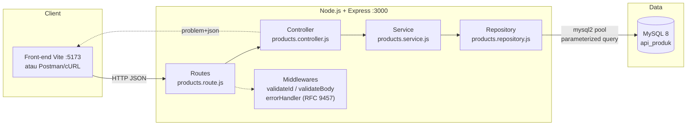
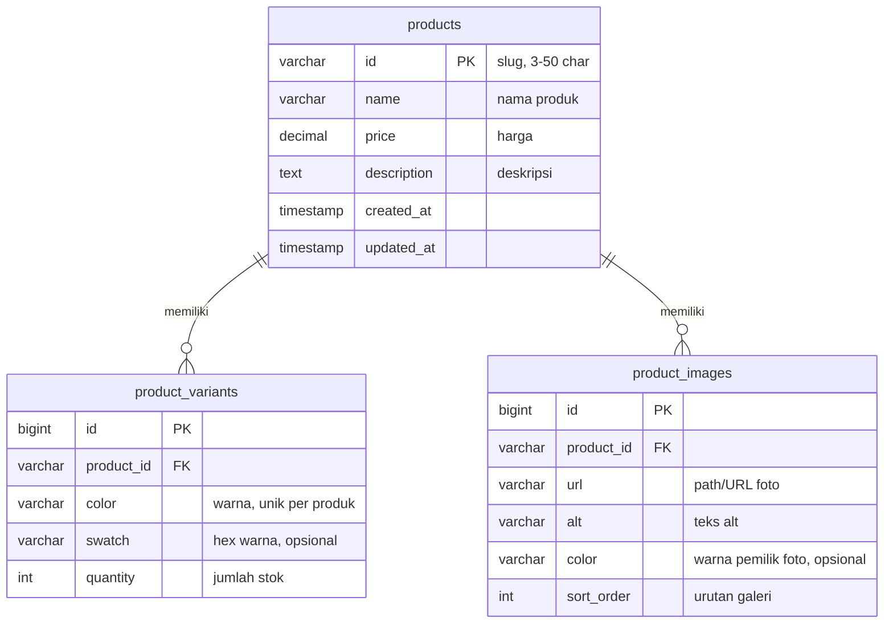

# Architecture Document — API Produk

| Informasi | Keterangan |
|-----------|------------|
| Dokumen | `context/architecture.md` (Arsitektur backend API produk) |
| Versi | 1.0 |
| Status | Draft untuk implementasi |
| Stack | **Node.js 20 LTS + Express** · **MySQL 8** · `mysql2` (promise pool) |
| Bahasa | Indonesia |
| Dokumen terkait | `context/prd.md` (kontrak API, validasi, test matrix) · `REQUIREMENTS.md` (FR/AC/US) |

**Keputusan utama arsitektur ini:**

1. Storage **in-memory** pada PRD (§15) **diganti MySQL 8** — data persisten antar restart.
2. Skema database **minimal** sesuai permintaan: **nama, harga, foto, variasi (warna + jumlah), deskripsi** — 3 tabel, 3NF.
3. **Kontrak API tetap** seperti PRD §8: sukses envelope `{ "data": ... }` (`application/json`), gagal **RFC 9457 Problem Details** (`application/problem+json`).

---

## 1. Ringkasan & Scope

### 1.1 Dalam scope

| Aspek | Keputusan |
|-------|-----------|
| Runtime | Node.js 20 LTS, Express 4 |
| Database | MySQL 8 (InnoDB, `utf8mb4`) |
| Akses DB | `mysql2/promise` pool + **parameterized query** (tanpa string concat) |
| Skema | `products` + `product_variants` + `product_images` (tabel §5) |
| Endpoint | `GET /api/products/:id` (MVP) + CRUD R2 (§PRD 8.5–8.8) |
| Validasi | Middleware app (400/409/415) **sebelum** query, ditambah constraint DB (CHECK/UNIQUE/FK) |
| Respon | Envelope `{data}` / `{data, meta}` + Problem Details RFC 9457 |

### 1.2 Di luar scope (perluasan nanti)

`category`, `availability`, `specs[]`, `usps[]`, `inTheBox[]`, `policies`, `story`, `support`, autentikasi, rate limiting, caching, full-text search. Jalur perluasannya ada di §14.

---

## 2. Tech Stack

| Layer | Pilihan | Alasan |
|-------|---------|--------|
| Runtime | Node.js 20 LTS | LTS stabil, native `fetch`, `crypto` |
| Framework | Express 4 | Ringan, sesuai guardrails (MVP 1 endpoint) |
| DB driver | `mysql2/promise` | Promise API, pool, placeholder `?` bawaan |
| Validasi | `zod` | Validasi body/query sebelum sentuh DB |
| Config | `dotenv` | Secret DB tidak di-hardcode |
| Security | `helmet`, `cors` | Header aman + CORS terkonfigurasi |
| Server MySQL | Docker Compose (`mysql:8.0`) | Reproduksi lokal tanpa install manual |
| **Dokumentasi API** | **OpenAPI 3.0** (`docs/openapi.yaml`) + `swagger-ui-express` | Spec statis terverifikasi; UI di `/api-docs` |
| Test | `scripts/smoke.js` + `scripts/integration.js` (MySQL ephemeral `mysql-memory-server`) | Test matrix PRD T1–T35 |

---

## 3. Arsitektur Layered



| Layer | Tanggung jawab | Boleh tahu SQL? |
|-------|----------------|-----------------|
| Route | Cocokkan path/method (§8.1), pasang middleware | Tidak |
| Controller | Parse req, panggil service, set status + envelope | Tidak |
| Service | Validasi bisnis, transaksi (CRUD), orkestrasi | Tidak |
| Repository | **Satu-satunya** tempat SQL; mapping row → object | Ya |
| errorHandler | 404 path & 500 → `application/problem+json` | Tidak |

Aturan: **SQL hanya boleh ada di `src/repositories/`** — memudahkan audit query & mencegah SQL injection tersebar.

### 3.1 Dokumentasi API — Swagger (OpenAPI 3.0)

| Hal | Nilai |
|-----|-------|
| Spec | `docs/openapi.yaml` — OpenAPI **3.0.3**, gaya **static spec** (anotasi tidak dicampur ke kode route) |
| Swagger UI | `GET /api-docs` (dari `swagger-ui-express`) |
| Spec mentah | `GET /openapi.yaml` (YAML) · `GET /openapi.json` (JSON) |
| Validasi spec | `npm run docs:openapi` — parse, cek field wajib, resolusi semua `$ref`, cek kontrak §8 (6 operasi) |
| Cakupan | Semua endpoint §8.1: `GET list`, `POST`, `GET/PUT/DELETE :id` — contoh request/response, skema `Product`/`Variant`/`Image`, envelope `{data}`/`{data, meta}`, **Problem RFC 9457** (semua kode error + header `Allow` pada 405) |

Spec diperlakukan **kontrak**: perubahan respons API harus diawali perubahan `openapi.yaml` (validasi `docs:openapi`), baru kode.

---

## 4. Struktur Folder

```
api-produk/
├── docker-compose.yml          # MySQL 8 lokal
├── .env                        # DB_HOST, DB_PORT, DB_USER, DB_PASS, DB_NAME, PORT
├── .env.example                # template (di-commit)
├── package.json
├── docs/
│   └── openapi.yaml            # spec OpenAPI 3.0 (kontrak §8) — sumber Swagger UI
├── scripts/
│   ├── run-sql.js              # eksekusi .sql via mysql2 (migrate/seed)
│   ├── validate-openapi.js     # validasi spec (npm run docs:openapi)
│   ├── smoke.js                # smoke test (npm run smoke)
│   └── integration.js          # MySQL ephemeral + migrate + seed + smoke (npm run test:integration)
├── db/
│   ├── migrations/
│   │   └── 001_init.sql        # DDL §5
│   └── seed.sql                # data awal §6
└── src/
    ├── server.js               # listen(PORT) + cek koneksi DB + graceful shutdown
    ├── app.js                  # express app, CORS, helmet, Swagger UI, routes, error handler
    ├── errors.js               # AppError + helper kode error (RFC 9457)
    ├── docs/
    │   └── loadSpec.js         # load docs/openapi.yaml (js-yaml)
    ├── config/
    │   └── db.js               # mysql2 pool
    ├── routes/
    │   └── products.route.js
    ├── controllers/
    │   └── products.controller.js
    ├── services/
    │   └── products.service.js
    ├── repositories/
    │   └── products.repository.js
    ├── middlewares/
    │   ├── validateId.js       # pola slug PRD §9.3
    │   ├── validateBody.js     # zod/ajv §9.2
    │   └── errorHandler.js     # RFC 9457 §9.5
    └── schemas/
        └── product.schema.js   # definisi validasi
```

---

## 5. Skema Database (MySQL 8)

### 5.1 ERD



### 5.2 DDL — `db/migrations/001_init.sql`

```sql
-- Database dibuat oleh docker-compose (MYSQL_DATABASE) atau manual:
--   CREATE DATABASE IF NOT EXISTS api_produk
--     DEFAULT CHARACTER SET utf8mb4 DEFAULT COLLATE utf8mb4_unicode_ci;
-- File ini sengaja TANPA CREATE DATABASE/USE — koneksi memakai DB_NAME dari .env.

-- 1. Produk: nama, harga, deskripsi
CREATE TABLE IF NOT EXISTS products (
  id          VARCHAR(50)    NOT NULL,                -- slug (PRD §9.3)
  name        VARCHAR(120)   NOT NULL,
  price       DECIMAL(12,2)  NOT NULL,
  description TEXT           NOT NULL,
  created_at  TIMESTAMP      NOT NULL DEFAULT CURRENT_TIMESTAMP,
  updated_at  TIMESTAMP      NOT NULL DEFAULT CURRENT_TIMESTAMP
                                ON UPDATE CURRENT_TIMESTAMP,
  PRIMARY KEY (id),
  CONSTRAINT chk_products_price CHECK (price >= 0)
) ENGINE=InnoDB DEFAULT CHARSET=utf8mb4 COLLATE=utf8mb4_unicode_ci;

-- 2. Variasi: warna + jumlah
CREATE TABLE IF NOT EXISTS product_variants (
  id         BIGINT       NOT NULL AUTO_INCREMENT,
  product_id VARCHAR(50)  NOT NULL,
  color      VARCHAR(30)  NOT NULL,                   -- 'Black', 'Silver'
  swatch     CHAR(7)      NULL,                       -- '#1b1b1b' (opsional)
  quantity   INT UNSIGNED NOT NULL DEFAULT 0,
  PRIMARY KEY (id),
  UNIQUE KEY uq_variant_product_color (product_id, color),
  CONSTRAINT fk_variant_product
    FOREIGN KEY (product_id) REFERENCES products (id) ON DELETE CASCADE,
  CONSTRAINT chk_variant_quantity CHECK (quantity >= 0)
) ENGINE=InnoDB DEFAULT CHARSET=utf8mb4 COLLATE=utf8mb4_unicode_ci;

-- 3. Foto produk
CREATE TABLE IF NOT EXISTS product_images (
  id         BIGINT       NOT NULL AUTO_INCREMENT,
  product_id VARCHAR(50)  NOT NULL,
  url        VARCHAR(500) NOT NULL,                   -- '/img/black-hero.png' atau 'https://...'
  alt        VARCHAR(160) NOT NULL DEFAULT '',
  color      VARCHAR(30)  NULL,                       -- foto milik varian warna tertentu (opsional)
  sort_order SMALLINT     NOT NULL DEFAULT 0,
  PRIMARY KEY (id),
  KEY idx_images_product (product_id, sort_order),
  CONSTRAINT fk_image_product
    FOREIGN KEY (product_id) REFERENCES products (id) ON DELETE CASCADE,
  CONSTRAINT chk_image_url CHECK (url REGEXP '^(https?://|/)')
) ENGINE=InnoDB DEFAULT CHARSET=utf8mb4 COLLATE=utf8mb4_unicode_ci;
```

### 5.3 Catatan desain

| Keputusan | Alasan |
|-----------|--------|
| `id` = **slug** (`mw75-tumi`), bukan `AUTO_INCREMENT` | Konsisten dengan PRD §9.3 & URL API `/api/products/:id` tanpa perubahan kontrak |
| Variasi & foto dipisah **tabel** | Warna+jumlah adalah repeating group → 3NF; menambah varian tidak menyentuh baris produk |
| `DECIMAL(12,2)` untuk harga | Tidak ada galat biner float; precision 2 desimal (USD) |
| `INT UNSIGNED` + `CHECK (>= 0)` | Jumlah tidak boleh negatif — dijaga di 2 lapis (app + DB) |
| `UNIQUE (product_id, color)` | Cegah duplikasi warna dalam 1 produk; jadi penjaga terakhir untuk `409` |
| `ON DELETE CASCADE` | Hapus produk → varian & foto ikut terhapus (riwayat di PRD §15) |
| `utf8mb4` | Aman untuk karakter non-ASCII (mis. `Bluetooth®`, `°`) |
| `CHECK url REGEXP` | Foto harus path relatif `/...` atau URL `http(s)://...` (FR-04/05) |
| Index | FK `product_id` ter-index bawaan InnoDB; `idx_images_product` menjamin urutan galeri |
| `swatch` **nullable** | Kolom pendukung UI varian; boleh kosong (FE pakai fallback) |

---

## 6. Mapping Skema ↔ Kontrak API

### 6.1 Traceability (skema minimal ↔ field API)

| Field API (dalam `data`) | Sumber DB | Status |
|--------------------------|-----------|--------|
| `id` | `products.id` | ✅ |
| `name` (nama produk) | `products.name` | ✅ |
| `price` (harga produk) | `products.price` | ✅ |
| `description` (deskripsi) | `products.description` | ✅ |
| `images[]` (foto produk) | `product_images` | ✅ |
| `variants[].color` (warna) | `product_variants.color` | ✅ |
| `variants[].quantity` (jumlah) | `product_variants.quantity` | ✅ |
| `variants[].swatch` | `product_variants.swatch` | ✅ opsional |
| `currency` | konstanta aplikasi `"USD"` | ➖ tanpa kolom (perluasan §14) |
| `category`, `availability`, `specs[]`, `usps[]`, `inTheBox[]`, `policies`, `story`, `support` | — | ⏳ di luar skema minimal (§14) |

### 6.2 Contoh respons sukses — `GET /api/products/:id`

```json
{
  "data": {
    "id": "mw75-tumi",
    "name": "MW75 TUMI",
    "price": 750,
    "currency": "USD",
    "description": "TUMI x Master & Dynamic MW75 — active noise-cancelling headphones dengan bahan lambskin leather dan aluminium anodized.",
    "images": [
      { "url": "/img/black-hero.png", "alt": "Floating black TUMI MW75 headphones", "color": "Black" },
      { "url": "/img/silver-hero.png", "alt": "Floating silver TUMI MW75 headphones", "color": "Silver" }
    ],
    "variants": [
      { "color": "Black", "swatch": "#1b1b1b", "quantity": 12 },
      { "color": "Silver", "swatch": "#c0c0c0", "quantity": 0 }
    ]
  }
}
```

### 6.3 Contoh respons list — `GET /api/products`

```json
{
  "data": [
    { "id": "mw75-tumi", "name": "MW75 TUMI", "price": 750, "currency": "USD" }
  ],
  "meta": { "total": 1, "limit": 10, "offset": 0 }
}
```

> List memakai **projection ringan** (tanpa `images[]`/`variants[]`/`description`) agar hemat I/O; payload lengkap cukup di `GET /:id`.
> Error (400/404/409/415/500) **tetap** RFC 9457 `application/problem+json` — contoh & skema di PRD §8.2 dan §9.5.

---

## 7. Data Access Layer

### 7.1 Pool — `src/config/db.js`

```js
const mysql = require('mysql2/promise');

const pool = mysql.createPool({
  host: process.env.DB_HOST || 'localhost',
  port: Number(process.env.DB_PORT || 3306),
  user: process.env.DB_USER,
  password: process.env.DB_PASS,
  database: process.env.DB_NAME || 'api_produk',
  waitForConnections: true,
  connectionLimit: 10,
  decimalNumbers: true, // DECIMAL → number (price bukan "750.00")
  timezone: 'Z',
  charset: 'utf8mb4_unicode_ci',
});

module.exports = pool;
```

> **Pitfall:** tanpa `decimalNumbers: true`, `mysql2` mengembalikan `DECIMAL` sebagai **string** → AC-03.1 (price `number`) gagal.

### 7.2 Repository — `src/repositories/products.repository.js`

```js
const pool = require('../config/db');

const SELECT_PRODUCT = `
  SELECT id, name, price, description
  FROM products
  WHERE id = ?`; // placeholder ? → aman dari SQL injection

async function findProductById(id) {
  const [rows] = await pool.query(SELECT_PRODUCT, [id]);
  return rows[0] ?? null;
}

async function findVariantsByProductId(id) {
  const [rows] = await pool.query(
    'SELECT color, swatch, quantity FROM product_variants WHERE product_id = ? ORDER BY id',
    [id]
  );
  return rows;
}

async function findImagesByProductId(id) {
  const [rows] = await pool.query(
    'SELECT url, alt, color FROM product_images WHERE product_id = ? ORDER BY sort_order, id',
    [id]
  );
  return rows;
}

async function insertProduct({ id, name, price, description }) {
  await pool.query(
    'INSERT INTO products (id, name, price, description) VALUES (?, ?, ?, ?)',
    [id, name, price, description]
  );
}

async function deleteProduct(id) {
  const [result] = await pool.query('DELETE FROM products WHERE id = ?', [id]);
  return result.affectedRows; // varian & foto ikut (CASCADE)
}

module.exports = {
  findProductById,
  findVariantsByProductId,
  findImagesByProductId,
  insertProduct,
  deleteProduct,
};
```

### 7.3 Assembly di service (tanpa N+1)

```js
// src/services/products.service.js
const repo = require('../repositories/products.repository');

async function getDetail(id) {
  const product = await repo.findProductById(id);        // query 1
  if (!product) return null;                             // → controller balas 404 RFC 9457

  const [variants, images] = await Promise.all([         // query 2 & 3 paralel
    repo.findVariantsByProductId(id),
    repo.findImagesByProductId(id),
  ]);

  return { ...product, currency: 'USD', variants, images };
}
```

> 3 query kecil per request (1 produk) lebih sederhana & cepat daripada JOIN bersarang; bila kelak butuh list lengkap, baru pertimbangkan agregasi.

### 7.4 Transaksi untuk tulis (POST/PUT/DELETE)

```js
const pool = require('../config/db');

async function createProduct(payload) {
  const conn = await pool.getConnection();
  try {
    await conn.beginTransaction();
    await conn.query('INSERT INTO products (id, name, price, description) VALUES (?, ?, ?, ?)',
      [payload.id, payload.name, payload.price, payload.description]);
    for (const v of payload.variants) {
      await conn.query('INSERT INTO product_variants (product_id, color, swatch, quantity) VALUES (?, ?, ?, ?)',
        [payload.id, v.color, v.swatch ?? null, v.quantity]);
    }
    for (const img of payload.images) {
      await conn.query('INSERT INTO product_images (product_id, url, alt, color, sort_order) VALUES (?, ?, ?, ?, ?)',
        [payload.id, img.url, img.alt ?? '', img.color ?? null, img.sortOrder ?? 0]);
    }
    await conn.commit();
  } catch (err) {
    await conn.rollback();   // tidak ada data setengah jadi
    throw err;               // duplikat UNIQUE → 409 DUPLICATE_ID (PRD §8.4)
  } finally {
    conn.release();
  }
}
```

`PUT` memakai pola sama: `DELETE` varian/foto lama (atau tulis ulang) + `UPDATE products` di dalam satu transaksi.

---

## 8. Alur Request

### 8.1 Sequence — `GET /api/products/:id`

```mermaid
sequenceDiagram
    actor U as Pengguna
    participant FE as Front-end
    participant API as Express (Node.js)
    participant DB as MySQL

    U->>FE: buka halaman detail
    FE->>API: GET /api/products/mw75-tumi
    API->>API: validateId (pola slug §9.3)
    alt id bukan slug
        API-->>FE: 400 problem+json VALIDATION_ERROR
    end
    API->>DB: SELECT products WHERE id = ?
    DB-->>API: rows
    alt produk tidak ada
        API-->>FE: 404 problem+json PRODUCT_NOT_FOUND
    else ada
        paralel
            API->>DB: SELECT product_variants WHERE product_id = ?
            API->>DB: SELECT product_images WHERE product_id = ?
        end
        DB-->>API: rows
        API-->>FE: 200 application/json { "data": {...} }
    end
```

### 8.2 Urutan validasi (ikuti PRD §10.1)

1. **Method** tak terdaftar → `405` + `Allow`
2. **Format `id`** (slug) → `400 VALIDATION_ERROR`
3. **Body/Content-Type** (POST/PUT) → `415` / `400`
4. **`UNIQUE (product_id, color)` / PK bentrok** → `409 DUPLICATE_ID`
5. **Lookup** tak ada → `404 PRODUCT_NOT_FOUND`
6. **Tulis** (transaksi) → `201` / `200` / `204`
7. **Tak terduga** → `500 INTERNAL_ERROR` (tanpa stacktrace)

---

## 9. Validasi Input

| # | Field | Aturan (app layer) | Penjaga DB |
|---|-------|--------------------|------------|
| 1 | `id` | wajib, pola slug `^[a-z0-9](?:[a-z0-9-]{1,48}[a-z0-9])?$` (PRD §9.3) | `PRIMARY KEY` |
| 2 | `name` | wajib, 3–120 karakter | `NOT NULL`, `VARCHAR(120)` |
| 3 | `price` | wajib, number ≥ 0, maks 2 desimal | `DECIMAL(12,2)` + `CHECK (>= 0)` |
| 4 | `description` | wajib, 10–5000 karakter | `NOT NULL`, `TEXT` |
| 5 | `variants` | wajib, minimal 1 item | — |
| 6 | `variants[].color` | wajib, 1–30 karakter, unik per produk | `UNIQUE (product_id, color)` |
| 7 | `variants[].quantity` | wajib, integer ≥ 0 | `INT UNSIGNED` + `CHECK` |
| 8 | `images` | wajib, minimal 1 item | — |
| 9 | `images[].url` | wajib, cocok `^(/|https://)` | `CHECK url REGEXP` |

Dua lapis = dua jaring pengaman: pesan `400` yang ramah datang dari app layer; constraint DB menjamin integritas walau ada request yang lolos (mis. lewat script SQL langsung).

---

## 10. Konfigurasi & Environment

`.env.example`:

```
PORT=3000
CORS_ORIGIN=http://localhost:5173

DB_HOST=localhost
DB_PORT=3306
DB_USER=app
DB_PASS=ganti_dengan_password_kuat
DB_NAME=api_produk
```

`docker-compose.yml`:

```yaml
services:
  mysql:
    image: mysql:8.0
    container_name: api-produk-mysql
    restart: unless-stopped
    environment:
      MYSQL_ROOT_PASSWORD: root_secret
      MYSQL_DATABASE: api_produk
      MYSQL_USER: app
      MYSQL_PASSWORD: app_secret
    ports:
      - "3306:3306"
    volumes:
      - mysql_data:/var/lib/mysql
    command: --character-set-server=utf8mb4 --collation-server=utf8mb4_unicode_ci

volumes:
  mysql_data:
```

---

## 11. Migration & Seed

```bash
docker compose up -d                 # 1. nyalakan MySQL
npm run db:migrate                   # 2. jalankan db/migrations/001_init.sql
npm run db:seed                      # 3. isi data awal (db/seed.sql)
npm start                            # 4. jalankan API → http://localhost:3000
```

`db/seed.sql` (minimal — 1 produk, 2 varian, 2 foto):

```sql
INSERT INTO products (id, name, price, description) VALUES
  ('mw75-tumi', 'MW75 TUMI', 750.00,
   'TUMI x Master & Dynamic MW75 — headphone nirkabel dengan active noise-cancelling.');

INSERT INTO product_variants (product_id, color, swatch, quantity) VALUES
  ('mw75-tumi', 'Black',  '#1b1b1b', 12),
  ('mw75-tumi', 'Silver', '#c0c0c0', 0);

INSERT INTO product_images (product_id, url, alt, color, sort_order) VALUES
  ('mw75-tumi', '/img/black-hero.png',  'TUMI MW75 Black — three-quarter view',  'Black',  1),
  ('mw75-tumi', '/img/silver-hero.png', 'TUMI MW75 Silver — three-quarter view', 'Silver', 1);
```

`package.json` (script):

```json
{
  "scripts": {
    "start": "node src/server.js",
    "dev": "node --watch src/server.js",
    "db:migrate": "node scripts/run-sql.js db/migrations/001_init.sql",
    "db:seed": "node scripts/run-sql.js db/seed.sql",
    "docs:openapi": "node scripts/validate-openapi.js",
    "smoke": "node scripts/smoke.js",
    "test:integration": "node scripts/integration.js"
  }
}
```

> Migration/seed dijalankan lewat **`scripts/run-sql.js` (mysql2)** — bukan CLI `mysql` — agar tidak butuh client mysql terpasang di mesin. File SQL sengaja tanpa `CREATE DATABASE`/`USE`: database dibuat docker-compose (`MYSQL_DATABASE`) dan nama diambil dari `DB_NAME`.

---

## 12. Keamanan & Reliability

| # | Praktik | Implementasi |
|---|---------|--------------|
| 1 | **SQL injection** | Selalu placeholder `?` (`pool.query(sql, [..])`); larang interpolasi string ke SQL |
| 2 | Least-privilege DB user | User `app` hanya `SELECT/INSERT/UPDATE/DELETE` pada `api_produk` — tanpa `DROP` |
| 3 | Secret tidak di-commit | `.env` di `.gitignore`; `.env.example` yang di-commit tanpa password |
| 4 | Stacktrace tidak bocor | `errorHandler` balas `500 INTERNAL_ERROR` generik (RFC 9457) — log server saja |
| 5 | Timeout & pool | `connectionLimit: 10`; tangkap `ER_CON_COUNT_ERROR` → 503/500 terkontrol |
| 6 | Graceful shutdown | Tutup pool saat `SIGTERM` sebelum `process.exit` |
| 7 | CORS & header | `cors({ origin: CORS_ORIGIN })` + `helmet()` (PRD §8.3) |
| 8 | Batas payload | `express.json({ limit: '100kb' })` → body raksasa ditolak lebih awal |

---

## 13. Pengujian

| Level | Alat | Fokus |
|-------|------|-------|
| Dokumentasi | `npm run docs:openapi` | Spec valid: field wajib, `$ref` teresolusi, kontrak §8 lengkap |
| Smoke (tanpa DB) | `npm run smoke` | Swagger UI hidup, 400 slug, 405+`Allow`, 404 path, 415, 413/JSON rusak, CORS preflight |
| Integration (DB penuh) | `npm run test:integration` | MySQL ephemeral (`mysql-memory-server`) → migrate → seed → app → **T1, T7, T10, T15, T22, T26, T28, T30, T32, T34, T35` (20 asersi) |
| Kontrak penuh | test matrix PRD T1–T35 | Header `Content-Type` (T13), problem+json (T14), `{data, meta}` (T22), urutan validasi (T35) |

Pengujian DB: pakai database terpisah + `TRUNCATE` per test agar tidak saling memengaruhi; jangan pakai DB produksi/seed untuk test.

---

## 14. Jalur Perluasan (di luar skema minimal)

| Kebutuhan | Perubahan skema |
|-----------|-----------------|
| `availability` (badge/CTA) | Tambah kolom `products.availability ENUM('in_stock','pre_order','sold_out') DEFAULT 'in_stock'` |
| `category` | Kolom `products.category VARCHAR(80)` atau tabel `categories` (relasi FK) |
| `specs[]`, `usps[]`, `inTheBox[]` | Tabel baru (`product_specs` dsb.) — **bukan** kolom JSON agar bisa diquery |
| Search (`?search=`) | `FULLTEXT INDEX (name, description)` |
| Pagination list | Sudah didukung `meta {total,limit,offset}` — tambah `LIMIT ? OFFSET ?` |
| Multi-currency | Kolom `products.currency CHAR(3) DEFAULT 'USD'` |
| Auth & rate limiting | Middleware `Authorization` + `express-rate-limit` (di luar scope exercise) |
| Foto lebih dari 1 varian | Tabel sudah mendukung: isi `product_images.color` per warna, filter di service |

---

## 15. Milestone Implementasi

| # | Milestone | Exit criteria |
|---|-----------|---------------|
| 1 | Infra DB | `docker compose up` sehat; `db:migrate` + `db:seed` sukses; tabel & data terverifikasi (SQL di §5/§11) |
| 2 | Layer dasar | Pool hidup (§7.1); `GET /:id` membaca 1 produk dari MySQL; envelope `{data}` |
| 3 | Assembly & error | Variasi + foto tergabung (§7.3); 400/404/409/415 problem+json (§8.2) |
| 4 | CRUD R2 | POST/PUT/DELETE transaksional (§7.4); list `{data, meta}` |
| 5 | QA & serah terima | Test matrix PRD T1–T35 lulus; DoD §18 PRD tercentang |

---

## 16. Risiko & Mitigasi

| # | Risiko | Mitigasi |
|---|--------|----------|
| 1 | `DECIMAL` terbaca sebagai string → `price` bukan number | `decimalNumbers: true` (§7.1) + assert type di test |
| 2 | Tulis parsial (produk masuk, varian gagal) | Transaksi + rollback (§7.4); `UNIQUE`/`CHECK` jaring pengaman |
| 3 | SQL injection | Placeholder `?` saja; review: SQL hanya di repository (§3) |
| 4 | Skema minimal ≠ payload PRD penuh (`specs[]`, `usps[]`, dll.) | Traceability §6.1; jalur perluasan §14 — FE tahu field mana yang belum ada |
| 5 | Kredensial DB bocor | `.env` tidak di-commit; user DB least-privilege (§12) |
| 6 | Data seed rusak gagal saat startup | Validasi ulang payload sebelum insert (skema PRD §9.2 untuk field yang dipakai) |
| 7 | Kontrak API berubah tak sengaja saat pindah ke MySQL | Envelope `{data}` + RFC 9457 dipertahankan persis (PRD §8) — diuji T13/T14/T22 |
