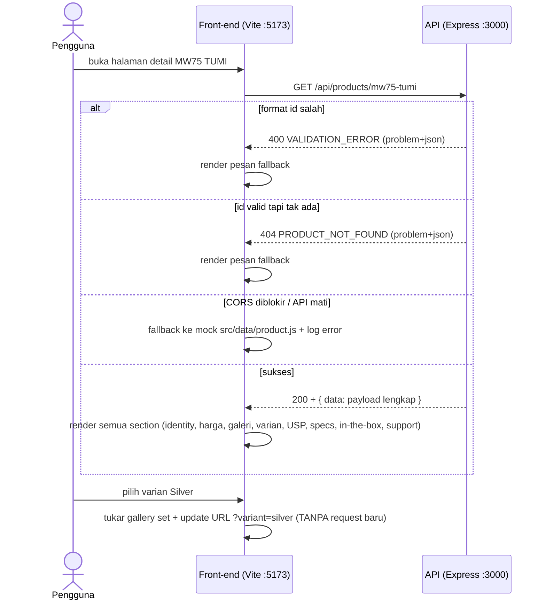

# PRD — Product Detail API (`api-produk`)

| | |
|---|---|
| **Role author** | Senior Product Owner |
| **Versi** | 3.0 |
| **Status** | Draft for review (v3 — panduan implementasi, glossary, milestone, klarifikasi kontrak) |
| **Tanggal** | 5 Oktober 2026 |
| **Guardrails** | `Practical Guidance - Modern Back-End Development with AI.docx` |
| **Dokumen terkait** | `REQUIREMENTS.md` (FR/AC/US/NFR), `DESIGN.md`, `TASK.md`, data front-end `src/data/product.js` |
| **Target release** | MVP (In Class Exercise) |

---

## 1. Ringkasan Produk

Membangun REST API sederhana dengan **Node.js (Express.js)** yang menyediakan data produk **MW75 TUMI Active Noise-Cancelling Wireless Headphones** untuk halaman **Detail Product 2** (hasil exercise front-end sebelumnya). Seluruh konten halaman detail produk harus ter-isi **otomatis dari response API**, bukan hardcode di front-end.

**Satu endpoint inti (MVP):**

```
GET /api/products/:id
```

Contoh request: `GET /api/products/mw75-tumi`

**Empat endpoint CRUD — Release 2 (menjadikan API CRUD utuh):**

| # | Method | Path | Fungsi | Sukses |
|---|--------|------|--------|--------|
| 1 | `GET` | `/api/products` | List + search + paginasi | `200` |
| 2 | `POST` | `/api/products` | Create | `201` |
| 3 | `PUT` | `/api/products/:id` | Update (full replace) | `200` |
| 4 | `DELETE` | `/api/products/:id` | Delete | `204` |

Spesifikasi lengkap keempat endpoint — contoh request/response (§8.5–§8.8), validasi (§10.3), user story + acceptance criteria (§7.11–§7.14), dan test (T22–T35) — ada di dokumen ini. MVP exercise tetap **1 endpoint GET** sesuai guardrails; CRUD adalah **Release 2** (§15).

Data produk di-hardcode di dalam code back-end (belum ada database), sesuai lingkup exercise. **Single source of truth** untuk data produk berpindah dari `src/data/product.js` ke API ini (selaras `NFR-04`).

**Untuk engineer:** mulai dari §13 (Panduan Implementasi — stack, struktur folder, cara menjalankan, common pitfalls) lalu §8 (kontrak endpoint). Glossary istilah ada di §5.

---

## 2. Latar Belakang & Tujuan

### 2.1 Latar Belakang

Halaman detail MW75 TUMI saat ini mengambil data dari `src/data/product.js` (mock lokal). Front-end perlu sumber data tunggal berupa API agar konten halaman dapat berubah tanpa mengubah code front-end, sekaligus memperkenalkan pola komunikasi front-end ↔ back-end.

**Catatan revisi v2.0:** contoh generik pada guardrails (`variants.colorOrSize: ["S","M","L"]`, `id: 1`, harga Rupiah) **tidak berlaku** untuk web pembelian headphone ini. Varian di `REQUIREMENTS.md` adalah **warna Black & Silver** (bukan ukuran), `id` memakai slug `mw75-tumi`, dan harga dalam **USD**. Pemetaan lengkap ada di §6.

### 2.2 Tujuan (Objectives)

1. Tersedia 1 REST API endpoint yang mengembalikan data produk sesuai field minimal guardrails **dan** seluruh kebutuhan halaman detail (`REQUIREMENTS.md` FR-04…FR-21).
2. Halaman detail product 2 seluruh kontennya terisi otomatis dari response API (0 hardcode untuk data produk).
3. Input dari client divalidasi sehingga request tidak valid ditolak dengan error yang jelas dan konsisten (`400` ≠ `404` ≠ `405` ≠ `500`).
4. Data hardcode terjamin valid melalui schema check saat startup (fail fast).
5. Developer memahami ruang lingkup kerja back-end dan cara kerja REST API secara garis besar.
6. **Release 2:** API menjadi **CRUD utuh** — 4 endpoint baru (list, create, update, delete) dengan validasi query/body yang lengkap, user story, dan acceptance criteria sendiri (§7.11–§7.14, §10.3).

### 2.3 Key Success Indicators

- Semua section halaman detail terisi dari API (identity, price, variant, gallery, USP, policies, story, description, specs, in-the-box, support).
- 100% request dengan `id` tidak valid mendapat `400` dengan body error terstruktur.
- Request dengan `id` valid namun tidak tersedia mendapat `404` (bukan `200` kosong / crash).
- Seluruh test matrix (§11) lulus.

---

## 3. Ruang Lingkup (Scope)

### 3.1 In Scope — MVP

- Endpoint `GET /api/products/:id` dengan **payload lengkap** (lihat §9).
- Data produk hardcode berbentuk **collection**: `const products = [ { ...mw75-tumi } ]` — array berisi 1 produk; lookup by `products.find(p => p.id === id)`. Struktur ini disiapkan agar penambahan produk cukup menambah elemen array, tanpa mengubah kode handler (lihat §13.5).
- Field inti: `id` (slug), `name`, `category`, `price`, `currency`, `availability`, `variants[]` (Black/Silver + `images[]` + `quantity`), `description`.
- Field section: `announcement`, `usps`, `policies`, `story`, `specs`, `inTheBox`, `support`, `newsletter`.
- Validasi input path parameter `id` (format slug), method, dan penanganan path/encoding.
- Validasi internal terhadap data hardcode (JSON Schema check saat startup).
- Respons error terstruktur (`400`, `404`, `405`, `500`) + standar header respons (§8.4).
- Konfigurasi CORS agar halaman front-end (origin/port berbeda) dapat memanggil API.
- Integrasi dengan halaman detail product 2 (field terisi otomatis).
- **Release 2 (CRUD)** — 4 endpoint baru: `GET /api/products` (list + query validasi), `POST /api/products`, `PUT /api/products/:id`, `DELETE /api/products/:id` — divalidasi penuh (§10.3), spec §8.5–§8.8. Penyimpanan **in-memory** (mutasi hilang saat restart — tanpa DB, sesuai lingkup exercise).

### 3.2 Out of Scope — MVP

- Database / persistence (data tetap hardcode).
- Autentikasi & otorisasi (API publik, read-only).
- Method yang tidak terdaftar untuk sebuah path (mis. `PATCH`, `POST /api/products/:id`) — tetap `405` (§8.4).
- **Site chrome** front-end yang bukan atribut produk: `nav`, `breadcrumb`, `footerGroups`, `legal`, `address`, `copyright`, dan `src/data/markets.js` — tetap dikonfigurasi lokal di front-end.
- Deployment ke production, HTTPS, rate limiting, log aggregation.
- Pembayaran, checkout, inventori/admin (non-goal `REQUIREMENTS.md` §3.2).

---

## 4. Persona

| ID | Persona | Kebutuhan utama |
|----|---------|-----------------|
| P1 | **Front-end Developer** | Response JSON stabil & sesuai kontrak agar seluruh section halaman detail terisi otomatis. |
| P2 | **End User (calon pembeli headphone premium)** | Melihat nama, kategori, harga, varian Black/Silver, galeri, USP, specs, isi paket dengan benar. |
| P3 | **Back-end Developer** | Kontrak API jelas, error konsisten, data hardcode ter-validasi saat startup. |
| P4 | **QA Engineer** | Aturan validasi dan kriteria penerimaan terdokumentasi → dapat ditest (test matrix §11). |

---

## 5. Glossary & Istilah Penting

Istilah yang dipakai di dokumen ini — khusus pembaca yang baru mempelajari back-end.

| Istilah | Arti |
|---------|------|
| **Slug** | `id` berbentuk teks huruf kecil/konsonan, contoh `mw75-tumi`. Bukan angka. |
| **Payload** | Isi body respons JSON yang dikirim API. |
| **RFC 9457 (Problem Details)** | Standar IETF untuk error HTTP — respons error memakai media type **`application/problem+json`** dengan field inti `type`, `title`, `status`, `detail`, `instance`; ditambah ekstensi `code` dan `errors[]` (lihat §8.4). **Standar error API yang dipakai PRD ini.** |
| **Envelope sukses** | Bungkus respons sukses: `{ "data": <payload> }`; list menambah `"meta": { total, limit, offset }` (§8.4). |
| **Ekstensi RFC 9457** | Field tambahan di luar field inti (di sini `code` & `errors[]`) — diizinkan eksplisit oleh RFC untuk kebutuhan aplikasi. |
| **Fail fast (startup check)** | Data divalidasi saat program mulai; jika rusak, proses berhenti sebelum sempat melayani request dengan data cacat (§10.2). |
| **Collection** | Kumpulan data sebagai satu unit; di sini array `products` yang berisi objek produk (§3.1). |
| **Site chrome** | Bagian UI tetap sebuah situs (header nav, footer, link legal) yang bukan data produk → di luar scope API (§3.2). |
| **Single source of truth** | Satu tempat definisi sebuah data; tidak ada duplikasi antar bagian (`NFR-04`). |
| **CORS** | Aturan browser yang mengatur apakah halaman di origin A boleh memanggil API di origin B. Tanpa konfigurasi CORS, fetch dari browser gagal walau API sehat. |
| **Strict routing** | Aturan path harfiah: `/products/x` dan `/products/x/` dianggap path berbeda → yang kedua `404` (§8.2). |
| **MoSCoW** | Skala prioritas: **M**ust / **S**hould / **C**ould / **W**on't (§7.1). |
| **Milestone** | Tahap pengiriman dengan exit criteria terverifikasi (§16). |
| **Idempoten** | Operasi yang aman diulang dengan hasil sama (`PUT`, `DELETE`); `POST` **tidak** idempoten. |
| **In-memory** | Data disimpan di memori proses server — **hilang saat restart**; itulah sifat storage CRUD pada exercise ini. |
| **201 / 204** | `201 Created` = sukses create (membawa body objek hasil create); `204 No Content` = sukses delete (tanpa body). |
| **Status code** | `400` = input salah · `404` = path/data tidak ada · `405` = method salah · `409` = bentrok (id sudah dipakai) · `415` = Content-Type salah · `500` = server error. |

---

## 6. Traceability — Guardrails ↔ REQUIREMENTS.md ↔ Field API

### 6.1 Field Minimal Guardrails → Skema API

| # | Field guardrails | Field API (§9) | Catatan |
|---|------------------|----------------|---------|
| 1 | Nama Product | `name` + `category` | "MW75 TUMI" + "Noise-Cancelling Wireless Headphones" (FR-06) |
| 2 | Harga Product | `price` + `currency` | `750` + `USD` → tampil `US$750.00` (FR-07) |
| 3 | Foto Product | `variants[].images[].src` | Hero = `variants[isDefault].images[0]` (FR-04) |
| 4 | Variasi — **Warna**/Ukuran | `variants[].id` / `label` / `swatch` | **Warna Black & Silver** — ukuran tidak relevan untuk headphones over-ear (FR-09) |
| 5 | Variasi — **Jumlah/Quantity** | `variants[].quantity` | Stok per varian (angka ≥ 0) |
| 6 | Deskripsi | `description.body` | Deskripsi MW75 (FR-18) |

> Keputusan: `colorOrSize` (array ukuran S/M/L) **digugurkan**; varian headphone hanya warna. Field `quantity` guardrails dipertahankan sebagai **stock per varian**.

### 6.2 Section Halaman ↔ Field API (REQUIREMENTS FR ↔ payload)

| Section halaman | FR | Field payload |
|-----------------|----|---------------|
| Product identity & price | FR-06, FR-07 | `name`, `category`, `price`, `currency` |
| Availability badge + CTA | FR-08, FR-11 | `availability` (state saja) |
| Color variant selector | FR-09, FR-10 | `variants[]` |
| Product gallery | FR-04, FR-05 | `variants[].images[]` |
| Announcement bar | — | `announcement` |
| USP strip (6 item) | FR-13 | `usps[]` |
| Trust cards (shipping/returns/protection) | FR-14, FR-15, FR-16 | `policies` |
| TUMI story | FR-17 | `story` |
| Product description | FR-18 | `description` |
| Tech specs | FR-19 | `specs[]` |
| In the box (7 item) | FR-20 | `inTheBox[]` |
| Support center | FR-21 | `support` |
| Newsletter label | FR-22 | `newsletter` |

> Field `material`, `driver`, `battery`, `bluetooth`, `microphone`, `weight`, `type` (`REQUIREMENTS.md` §1.1) **bukan field terpisah** — nilainya bersumber dari `specs[]` (mencegah duplikasi, selaras `NFR-04`).
>
> Mapping `availability` → badge label / CTA label / `disabled` (tabel §1.2 `REQUIREMENTS.md`) tetap menjadi konfigurasi **front-end**; API hanya mengirim **state** `availability`.

---

## 7. User Story & Acceptance Criteria

Format: **Given / When / Then**. Kolom "Ref" menyeberang ke ID `REQUIREMENTS.md`.

### 7.1 Prioritas (MoSCoW)

| Prioritas | User story | Alasan |
|-----------|-----------|--------|
| **Must** (MVP) | US-01 (payload), US-03 (validasi id), US-04 (404 terstruktur), US-05 (startup check), US-07 (CORS) | Kontrak inti + validasi input — tanpa ini MVP gagal |
| **Should** (MVP) | US-02 (varian), US-06 (standar respons RFC 9457), US-08 (availability→CTA), US-09 (specs & in-the-box) | Pengalaman lengkap halaman sesuai `REQUIREMENTS.md` |
| **Must** (Release 2) | US-10 (list), US-11 (create), US-12 (update), US-13 (delete) | **API CRUD utuh** — keempatnya wajib ada agar R2 dinyatakan selesai |

> Semua **Must** + **Should** MVP wajib lulus sebelum MVP dinyatakan selesai (DoD §18 bagian 1); keempat **Must Release 2** wajib lulus untuk DoD bagian 2 (API CRUD utuh).

### 7.2 US-01 — Ambil payload lengkap halaman detail (happy path)
> **Sebagai** front-end developer, **saya ingin** mengambil seluruh data produk hanya dari satu endpoint, **supaya** halaman detail product 2 terisi otomatis dari API.

| Ref | AC |
|-----|----|
| FR-04…FR-21, AC-01 | |

- **Given** server berjalan dan data hardcode memuat product `mw75-tumi`
- **When** client mengirim `GET /api/products/mw75-tumi`
- **Then** respons `200 OK` dengan `Content-Type: application/json; charset=utf-8`
- **And** body berbentuk envelope `{ "data": {...} }`; `data` berisi seluruh field §9: core, `variants` (2 varian × 4 gambar), `usps` (6), `policies`, `story`, `description`, `specs` (3 group), `inTheBox` (7), `support`, `newsletter`, `announcement`
- **And** `data` **tidak** memuat field site chrome (`nav`, `breadcrumb`, `footerGroups`, `legal`, `address`, `copyright`)

**AC-01.2**
- **Given** respons diterima halaman detail
- **When** front-end me-render payload (`body.data`)
- **Then** seluruh section terisi dari API: identity, harga `US$750.00`, galeri, varian, USP, trust cards, story, description, tech specs, in-the-box, support — tidak ada nilai produk yang di-hardcode di front-end

**AC-01.3**
- **Given** request berhasil
- **When** body dibaca
- **Then** `data.price` bertipe `number` (`750`), `data.currency` = `"USD"`, `data.availability` ∈ enum yang sah, dan setiap `data.variants[].images[].src` diawali `/` atau `https://`

---

### 7.3 US-02 — Pilih varian Black / Silver
> **Sebagai** calon pembeli, **saya ingin** data kedua varian warna lengkap dalam satu respons, **supaya** pemilihan varian langsung memperbarui galeri tanpa request tambahan.

| Ref | AC |
|-----|----|
| FR-09, FR-10, AC-05, AC-06, AC-18, BHV-02, BHV-03 | |

- **Given** payload berisi `variants` dengan `id = "black"` (default) dan `id = "silver"`
- **When** front-end membuka halaman tanpa query
- **Then** varian default (`isDefault: true`) menjadi active state awal, galeri menampilkan `images[]` varian tersebut
- **Given** pengguna memilih **Silver**
- **When** state berubah
- **Then** galeri menukar set gambar ke `variants[silver].images`, alt text ikut berubah, URL menjadi `?variant=silver`
- **And** `quantity` per varian tersedia untuk ditampilkan (stok/badge bila dikonfigurasi)

**AC-02.2 — varian tidak dikenal di URL**
- **Given** halaman dibuka dengan `?variant=gold` (tidak ada di payload)
- **When** front-end mencocokkan dengan `variants[].id`
- **Then** fallback ke varian default **tanpa error** (BHV-03) — front-end tidak mengirim `variant` ke API (payload sudah memuat semua varian)

---

### 7.4 US-03 — Tolak input `id` tidak valid
> **Sebagai** QA engineer, **saya ingin** setiap input divalidasi, **supaya** request sampah ditolak sebelum diproses dan error mudah dipahami.

| Ref | AC |
|-----|----|
| Validasi input (spec `init.txt`) | |

**AC-03.1** — `id` bukan slug (huruf besar / karakter terlarang)
- **Given** server berjalan
- **When** client mengirim `GET /api/products/MW75-TUMI` atau `GET /api/products/mw75_tumi` atau `GET /api/products/1%20OR%201=1`
- **Then** respons `400 Bad Request` dengan `Content-Type: application/problem+json`
- **And** body berupa Problem Details RFC 9457: `status = 400`, `code = "VALIDATION_ERROR"`, dan `errors[0].field = "id"`

**AC-03.2** — `id` tidak format slug
- **When** client mengirim `GET /api/products/-mw75`, `GET /api/products/mw75-`, `GET /api/products/..`, atau slug > 50 karakter
- **Then** respons `400` + `VALIDATION_ERROR`, tidak pernah crash / unhandled exception

**AC-03.3** — tanpa id
- **When** client mengirim `GET /api/products/`
- **Then** route tidak cocok → `404` + `code = "NOT_FOUND"` (endpoint tidak ditemukan, problem+json)

---

### 7.5 US-04 — Product tidak ditemukan
> **Sebagai** front-end developer, **saya ingin** respons `404` yang terstruktur, **supaya** halaman dapat menampilkan pesan fallback yang ramah.

| Ref | AC |
|-----|----|
| FR-08 (state), AC-01 | |

- **Given** server berjalan dan slug `airpods-max` tidak ada di data hardcode
- **When** client mengirim `GET /api/products/airpods-max`
- **Then** respons `404 Not Found` (`application/problem+json`) dengan `code = "PRODUCT_NOT_FOUND"`
- **Given** respons `404` diterima halaman detail
- **When** front-end menangani error
- **Then** halaman menampilkan state error/fallback, bukan halaman kosong atau crash

---

### 7.6 US-05 — Data hardcode terjamin valid
> **Sebagai** back-end developer, **saya ingin** data hardcode divalidasi terhadap schema saat startup, **supaya** data rusak gagal fast-fail dan tidak pernah menghasilkan response cacat.

| Ref | AC |
|-----|----|
| NFR-04 (single source of truth) | |

**AC-05.1**
- **Given** aplikasi dijalankan dengan `npm start`
- **When** data hardcode lolos JSON Schema §9.2
- **Then** server start normal

**AC-05.2**
- **Given** data hardcode sengaja dirusak (mis. `price` bertipe string, `availability: "ready"`, `swatch: "biru"`, dua varian `isDefault: true`, atau `inTheBox` hanya 6 item)
- **When** aplikasi dijalankan
- **Then** proses startup gagal (exit non-zero) dengan pesan yang menunjuk field bermasalah

---

### 7.7 US-06 — Konsistensi respons error (RFC 9457)
> **Sebagai** front-end developer, **saya ingin** semua error berformat Problem Details standar, **supaya** saya cukup menulis satu handler error.

| Ref | AC |
|-----|----|
| AC-01 | |

- **Given** request yang gagal (`400`/`404`/`405`/`409`/`415`/`500`)
- **When** body respons dibaca
- **Then** `Content-Type` = `application/problem+json; charset=utf-8`
- **And** body selalu memuat field inti RFC 9457: `type`, `title`, `status`, `detail`, `instance` — plus ekstensi `code` (mesin) dan `errors[]` bila error terkait field
- **And** respons **sukses** berbentuk `{ "data": ... }` dengan `Content-Type: application/json` — front-end membedakan sukses/gagal lewat **status code**, bukan menebak bentuk body

---

### 7.8 US-07 — Akses dari halaman front-end (CORS)
> **Sebagai** front-end developer, **saya ingin** API dapat dipanggil dari origin halaman product, **supaya** integrasi tidak diblokir browser.

| Ref | AC |
|-----|----|
| FR-24 (halaman), integrasi API | |

- **Given** halaman front-end berjalan di origin/port berbeda dari API
- **When** front-end memanggil `GET /api/products/mw75-tumi`
- **Then** request tidak diblokir CORS dan respons dapat dibaca front-end
- **And** preflight `OPTIONS` dijawab tanpa error dan membawa header `Access-Control-Allow-Origin`

---

### 7.9 US-08 — Status ketersediaan konsisten dengan CTA
> **Sebagai** calon pembeli, **saya ingin** status ketersediaan berasal dari data produk, **supaya** badge dan tombol CTA tidak kontradiktif.

| Ref | AC |
|-----|----|
| FR-08, FR-11, AC-08, BHV-04 | |

- **Given** payload `availability = "sold_out"`
- **When** front-end me-render purchase panel
- **Then** badge **Sold out / Pre-Order** dan CTA **ADD TO CART** `disabled` + `aria-disabled="true"` — keduanya diturunkan dari **satu state** di API (bukan dua teks hardcode terpisah)

---

### 7.10 US-09 — Baca spesifikasi & isi paket dari API
> **Sebagai** calon pembeli, **saya ingin** tech specs dan isi paket tersedia lewat API, **supaya** informasi teknis selalu konsisten dengan data produk.

| Ref | AC |
|-----|----|
| FR-19, FR-20, AC-10, AC-11 | |

- **Given** payload berisi `specs[]` (3 group) dan `inTheBox[]` (7 item)
- **When** halaman me-render `<dl>` per group dan grid isi paket
- **Then** seluruh kelompok spesifikasi terbaca (label/value terpisah `<dt>`/`<dd>`) dan tepat 7 item paket tampil

---

### 7.11 US-10 *(Release 2)* — List produk dengan pencarian & paginasi
> **Sebagai** admin/tooling, **saya ingin** menampilkan daftar seluruh produk dengan filter dan paginasi, **supaya** saya dapat menjelajahi katalog tanpa mengetahui `id`.

| Ref | AC |
|-----|----|
| CRUD-GET (§8.5) | |

**AC-10.1 — happy path**
- **Given** server berjalan dengan collection `products`
- **When** client mengirim `GET /api/products`
- **Then** respons `200` dengan envelope `{ "data": [...], "meta": { "total": n, "limit": 10, "offset": 0 } }`
- **And** tiap elemen `data` adalah payload produk lengkap §9.1 (bukan ringkasan)

**AC-10.2 — search & paginasi valid**
- **Given** collection memuat produk `mw75-tumi`
- **When** client mengirim `GET /api/products?search=mw75&limit=5&offset=0`
- **Then** respons `200`; `items` hanya berisi produk yang cocok (case-insensitive terhadap `id`, `name`, `category`); `total` = jumlah hasil tersaring

**AC-10.3 — query tidak valid**
- **When** client mengirim `?limit=0`, `?limit=abc`, `?limit=101`, `?offset=-1`, `?search=<101 karakter>`, atau `?availability=ready`
- **Then** respons `400` + Problem Details (`code = "VALIDATION_ERROR"`)
- **And** `errors[0].field` menunjuk param bermasalah (`limit`/`offset`/`search`/`availability`)

**AC-10.4 — query tak dikenal**
- **When** `GET /api/products?foo=1`
- **Then** respons `200` — param tak dikenal diabaikan (konsisten dengan V6, §10.1)

---

### 7.12 US-11 *(Release 2)* — Create produk baru
> **Sebagai** admin, **saya ingin** menambahkan produk baru dengan data tervalidasi, **supaya** katalog hanya memuat data yang konsisten.

| Ref | AC |
|-----|----|
| CRUD-POST (§8.6) | |

**AC-11.1 — create sukses**
- **Given** server berjalan dan body adalah objek produk valid seluruhnya (§9.2) dengan `id` yang belum dipakai
- **When** client mengirim `POST /api/products` dengan `Content-Type: application/json`
- **Then** respons `201 Created` (`Content-Type: application/json`) + envelope `{ "data": {...} }` berisi objek produk persis seperti yang diterima
- **And** `GET /api/products` selanjutnya menunjukkan `meta.total` bertambah 1

**AC-11.2 — body tidak valid**
- **Given** body memuat `price: "750"` (string), `name` kosong, atau field wajib hilang (mis. `variants`)
- **When** client mengirim `POST /api/products`
- **Then** respons `400` dengan `Content-Type: application/problem+json`, `code = "VALIDATION_ERROR"`, dan `errors[]` berisi **semua** field yang gagal (bukan hanya yang pertama)
- **And** collection **tidak berubah** (`meta.total` tetap)

**AC-11.3 — id bentrok**
- **Given** `mw75-tumi` sudah ada di collection
- **When** client mengirim body valid dengan `"id": "mw75-tumi"`
- **Then** respons `409 Conflict` (problem+json) dengan `code = "DUPLICATE_ID"`
- **And** collection tidak berubah

**AC-11.4 — Content-Type salah / body rusak**
- **When** request memakai `Content-Type: text/plain`, atau body bukan JSON yang valid
- **Then** respons `415` + `code = "UNSUPPORTED_MEDIA_TYPE"` (Content-Type salah) atau `400` + `code = "VALIDATION_ERROR"` (JSON rusak) — keduanya problem+json

---

### 7.13 US-12 *(Release 2)* — Update produk (full replace)
> **Sebagai** admin, **saya ingin** memperbarui seluruh data produk secara atomik, **supaya** tidak ada field yang terlewat saat pengubahan.

| Ref | AC |
|-----|----|
| CRUD-PUT (§8.7) | |

**AC-12.1 — update sukses**
- **Given** produk `mw75-tumi` ada dan body adalah objek produk valid seluruhnya (§9.2) dengan `"id": "mw75-tumi"` (sama dengan path)
- **When** client mengirim `PUT /api/products/mw75-tumi`
- **Then** respons `200` + envelope `{ "data": {...} }` berisi objek produk hasil update
- **And** `GET /api/products/mw75-tumi` mengembalikan nilai terbaru

**AC-12.2 — id tidak ditemukan**
- **When** `PUT /api/products/airpods-max` dengan body valid
- **Then** respons `404` + `code = "PRODUCT_NOT_FOUND"` (problem+json) — data tidak berubah

**AC-12.3 — id di body ≠ id di path**
- **When** `PUT /api/products/mw75-tumi` dengan body `"id": "produk-lain"`
- **Then** respons `400` (problem+json) dengan `errors[0].field = "id"`

**AC-12.4 — body parsial (bukan full replace)**
- **When** body tidak memuat field wajib (mis. `specs` dihilangkan)
- **Then** respons `400` + `code = "VALIDATION_ERROR"` — update tidak sebagian

**AC-12.5 — idempoten**
- **Given** update sukses dilakukan
- **When** `PUT` yang sama diulang dengan body identik
- **Then** hasil `200` dengan data sama dan `total` tidak berubah

---

### 7.14 US-13 *(Release 2)* — Delete produk
> **Sebagai** admin, **saya ingin** menghapus produk dari katalog, **supaya** produk yang tak dijual tidak muncul di list.

| Ref | AC |
|-----|----|
| CRUD-DELETE (§8.8) | |

**AC-13.1 — delete sukses**
- **Given** produk `mw75-tumi` ada di collection
- **When** client mengirim `DELETE /api/products/mw75-tumi`
- **Then** respons `204 No Content` **tanpa body**
- **And** `GET /api/products` menunjukkan `total` berkurang 1; `GET /api/products/mw75-tumi` → `404`

**AC-13.2 — id tidak ditemukan**
- **When** `DELETE /api/products/airpods-max`
- **Then** respons `404` + `PRODUCT_NOT_FOUND`

**AC-13.3 — id salah format**
- **When** `DELETE /api/products/MW75`
- **Then** respons `400` + `VALIDATION_ERROR` (validasi format dijalankan **sebelum** lookup)

**AC-13.4 — double delete**
- **When** `DELETE` yang sama dikirim dua kali
- **Then** pertama `204`, kedua `404` — perilaku tereksplisit dan stabil

---

## 8. Spesifikasi API

### 8.1 Daftar Endpoint

| Method | Path | Release | Auth | Deskripsi | Sukses |
|--------|------|---------|------|-----------|--------|
| `GET` | `/api/products` | **R2** | Tidak | List + search + paginasi (§8.5) | `200` |
| `POST` | `/api/products` | **R2** | Tidak | Create produk baru (§8.6) | `201` |
| `GET` | `/api/products/:id` | **MVP** | Tidak | Ambil satu produk — payload lengkap (§8.2) | `200` |
| `HEAD` | `/api/products/:id` | **MVP** | Tidak | Otomatis didukung Express (header saja, tanpa body) | `200` |
| `PUT` | `/api/products/:id` | **R2** | Tidak | Update full-replace (§8.7) | `200` |
| `DELETE` | `/api/products/:id` | **R2** | Tidak | Hapus produk (§8.8) | `204` |

- **Method di luar tabel ini untuk path di atas** (mis. `PATCH`, `POST /api/products/:id`) → `405` + header `Allow` berisi daftar method yang benar (§8.4).
- **Release:** **MVP** = wajib (1 endpoint, guardrails); **R2** = Release 2 yang menjadikan API ini CRUD utuh — diuji T22–T35.

Base URL (dev): `http://localhost:3000` — konfigurasi via `.env` (§13.4).

### 8.2 `GET /api/products/:id`

**Path parameter**

| Param | Tipe | Wajib | Aturan |
|-------|------|-------|--------|
| `id` | string (slug) | Ya | Harus cocok `^[a-z0-9](?:[a-z0-9-]{1,48}[a-z0-9])?$` — huruf kecil/angka/tanda hubung, 3–50 karakter, tanpa `-` di awal/akhir |

**Aturan path & encoding**

| Kasus | Perilaku |
|-------|----------|
| Trailing slash | **Strict routing aktif** — `/api/products/mw75-tumi/` ≠ `/api/products/mw75-tumi` → `404 NOT_FOUND` |
| URL encoding | Path di-decode dulu, hasil decode dipola ulang; `%2D`, `%20`, dsb. yang menghasilkan di luar pola → `400` |
| Query string | Tidak ada query MVP; param tak dikenal **diabaikan** (tidak error) — `?variant=` divalidasi Q1 (§10.3.6); query list divalidasi §10.3.2 |
| Method | Selain yang terdaftar untuk path ini (§8.1) → `405 METHOD_NOT_ALLOWED` + header `Allow` (MVP `GET, HEAD`; R2 menambah `POST`, `PUT`, `DELETE`) |

**Contoh request**

```http
GET /api/products/mw75-tumi HTTP/1.1
Host: localhost:3000
Accept: application/json
```

**Respons sukses — `200 OK`**

> Envelope sukses standar PRD ini: seluruh respons sukses memakai `{ "data": <payload> }`.
> Isi `data` di bawah adalah objek produk lengkap §9.1 — dipetakan 1:1 sesuai skema §9.2.

```json
{
  "data": {
    "id": "mw75-tumi",
    "name": "MW75 TUMI",
    "category": "Noise-Cancelling Wireless Headphones",
    "price": 750,
    "currency": "USD",
    "availability": "sold_out",
    "announcement": "Free US Ground shipping on orders of $99 or more.",
    "variants": [
      {
        "id": "black",
        "label": "Black",
        "swatch": "#1b1b1b",
        "isDefault": true,
        "quantity": 12,
        "images": [
          {
            "src": "/img/black-hero.png",
            "alt": "Floating black TUMI MW75 Active Noise-Cancelling headphones — three-quarter view"
          },
          {
            "src": "/img/black-front.png",
            "alt": "Black TUMI MW75 headphones — front view"
          },
          {
            "src": "/img/black-engraving.png",
            "alt": "Close-up of TUMI 19 Degree engraving detail on black MW75 headphones"
          },
          {
            "src": "/img/black-straight.png",
            "alt": "Black TUMI MW75 headphones — straight side profile view"
          }
        ]
      },
      {
        "id": "silver",
        "label": "Silver",
        "swatch": "#cfcfcf",
        "isDefault": false,
        "quantity": 8,
        "images": [
          {
            "src": "/img/silver-hero.png",
            "alt": "Floating silver TUMI MW75 Active Noise-Cancelling headphones — three-quarter view"
          },
          {
            "src": "/img/silver-front.png",
            "alt": "Silver TUMI MW75 headphones — front view"
          },
          {
            "src": "/img/silver-engraving.png",
            "alt": "Close-up of TUMI 19 Degree engraving detail on silver MW75 headphones"
          },
          {
            "src": "/img/silver-straight.png",
            "alt": "Silver TUMI MW75 headphones — straight side profile view"
          }
        ]
      }
    ],
    "usps": [
      {
        "icon": "/img/icon-anc.svg",
        "label": "ANC"
      },
      {
        "icon": "/img/icon-headphones.svg",
        "label": "Anodized aluminum, tempered glass and lambskin leather"
      },
      {
        "icon": "/img/icon-driver.svg",
        "label": "40mm beryllium drivers"
      },
      {
        "icon": "/img/icon-battery.svg",
        "label": "32 hours of listening"
      },
      {
        "icon": "/img/icon-bluetooth.svg",
        "label": "Bluetooth® 5.1"
      },
      {
        "icon": "/img/icon-mic.svg",
        "label": "4 beamforming microphones"
      }
    ],
    "policies": {
      "shipping": {
        "title": "Free Shipping",
        "body": "Free ground shipping on orders of $99 or more in the U.S."
      },
      "returns": {
        "title": "Free Returns",
        "body": "We offer a 14-day return policy, allowing you to shop with confidence."
      },
      "warranty": {
        "title": "Product Protection",
        "body": "Rest easy with our manufacturer warranty, ensuring that your product is protected against any manufacturing defects or issues.",
        "linkLabel": "manufacturer warranty",
        "linkHref": "#"
      }
    },
    "story": {
      "eyebrow": "Master & Dynamic for",
      "title": "TUMI",
      "image": "/img/tumi-feature.png",
      "imageAlt": "TUMI × Master & Dynamic collaboration — MW75 headphones and earphones",
      "body": "A collection of active noise-cancelling sound tools created in partnership with the international travel and lifestyle brand built to enhance any journey."
    },
    "description": {
      "eyebrow": "MW75",
      "title": "Active Noise-Cancelling Wireless Headphones",
      "image": "/img/mw75-feature.png",
      "imageAlt": "Black TUMI MW75 headphones resting on a travel surface",
      "body": "The MW75 Active Noise-Cancelling Wireless Headphones deliver detailed, serious acoustics and custom-tailored sound with 40mm Beryllium drivers and Adaptive Active Noise Cancellation.",
      "links": [
        {
          "label": "Learn more",
          "prefix": "about MW75",
          "href": "#"
        },
        {
          "label": "here",
          "prefix": "Discover the full TUMI collaboration",
          "href": "#"
        }
      ]
    },
    "specs": [
      {
        "group": "Materials and Design",
        "items": [
          {
            "label": "Materials",
            "value": "Lambskin leather headband and ear pads/anodized aluminum controls"
          },
          {
            "label": "Dimensions",
            "value": "160.75mm x 197.83mm x 83.57mm"
          },
          {
            "label": "Weight",
            "value": "338g"
          },
          {
            "label": "Ear Coupling",
            "value": "Over-Ear"
          },
          {
            "label": "Ear Pads",
            "value": "Replaceable magnetic lambskin-wrapped memory foam"
          }
        ]
      },
      {
        "group": "Sound and Features",
        "items": [
          {
            "label": "Drivers",
            "value": "40mm beryllium"
          },
          {
            "label": "Impedance",
            "value": "32 Ohms"
          },
          {
            "label": "Talk Microphones",
            "value": "4 Microphone talk solution with wind protection"
          },
          {
            "label": "ANC Microphones",
            "value": "4 Microphone ANC solution"
          },
          {
            "label": "Voice Assistant",
            "value": "Compatible with native voice assistants"
          }
        ]
      },
      {
        "group": "Connectivity and Charging",
        "items": [
          {
            "label": "Battery Life",
            "value": "Up to 32 hours of battery life or up to 28 hours with ANC enabled"
          },
          {
            "label": "Bluetooth Profile",
            "value": "Bluetooth® 5.1 range of 100ft/30m with AAC, aptX™ Adaptive up to 24 bit/48kHz, and SBC."
          },
          {
            "label": "Wired Digital",
            "value": "Supports hi-res audio up to 24-bit / 96kHz using provided USB-C to USB-C cable with supported devices"
          },
          {
            "label": "Analog",
            "value": "USB-C to 3.5mm cable for optional analog audio connection"
          },
          {
            "label": "Cables",
            "value": "USB-C to 3.5mm audio cable, USB-C to USB-C charging cable"
          },
          {
            "label": "Antenna",
            "value": "Internal Antenna"
          }
        ]
      }
    ],
    "inTheBox": [
      {
        "name": "Wireless Headphones",
        "image": "/img/box-headphones.png"
      },
      {
        "name": "USB-C to USB-C Charging Cable",
        "image": "/img/box-usbc-usbc.png"
      },
      {
        "name": "USB-C to 3.5mm Audio Cable",
        "image": "/img/box-usbc-35.png"
      },
      {
        "name": "USB-C to USB-A Adapter",
        "image": "/img/box-usbc-usba.png"
      },
      {
        "name": "3.5mm to 1/4\" Adapter",
        "image": "/img/box-35-quarter.png"
      },
      {
        "name": "Flight Adapter",
        "image": "/img/box-flight.png"
      },
      {
        "name": "Hard Shell Travel Case",
        "image": "/img/box-case.png"
      }
    ],
    "support": {
      "title": "Need support? We’re here to assist you every step of the way.",
      "body": "Access product support and frequently asked questions in our Support Center",
      "ctaLabel": "Support Center",
      "ctaHref": "https://support.masterdynamic.com",
      "image": "/img/support-bg.jpg"
    },
    "newsletter": "Sign up for early access, news and exclusive offers"
  }
}
```

**Respons gagal — `400 Bad Request` (validasi)**

> Semua respons gagal memakai **`Content-Type: application/problem+json`** sesuai **RFC 9457 (Problem Details)**: field inti `type`, `title`, `status`, `detail`, `instance` — ditambah ekstensi `code` (machine-readable) dan `errors[]` (detail per field).

```json
{
  "type": "/problems/validation-error",
  "title": "Validation Error",
  "status": 400,
  "detail": "Parameter 'id' tidak valid",
  "instance": "/api/products/MW75-TUMI",
  "code": "VALIDATION_ERROR",
  "errors": [
    { "field": "id", "rule": "pattern", "value": "MW75-TUMI", "message": "Harus berupa slug huruf kecil (a-z, 0-9, tanda hubung)" }
  ]
}
```

**Respons gagal — `404 Not Found` (data)**

```json
{
  "type": "/problems/product-not-found",
  "title": "Product Not Found",
  "status": 404,
  "detail": "Product dengan id 'airpods-max' tidak ditemukan",
  "instance": "/api/products/airpods-max",
  "code": "PRODUCT_NOT_FOUND"
}
```

**Respons gagal — `405 Method Not Allowed`** (disertai header `Allow`)

```json
{
  "type": "/problems/method-not-allowed",
  "title": "Method Not Allowed",
  "status": 405,
  "detail": "Method 'PATCH' tidak didukung untuk resource ini.",
  "instance": "/api/products/mw75-tumi",
  "code": "METHOD_NOT_ALLOWED"
}
```

**Respons gagal — `500 Internal Server Error` (tak terduga)**

```json
{
  "type": "/problems/internal-error",
  "title": "Internal Server Error",
  "status": 500,
  "detail": "Terjadi kesalahan pada server",
  "instance": "/api/products/mw75-tumi",
  "code": "INTERNAL_ERROR"
}
```

> **Catatan keputusan — standar respons PRD ini:**
> - **Sukses** → `application/json` dengan envelope `{ "data": <payload> }` (list menambah `"meta"`).
> - **Gagal** → `application/problem+json` **RFC 9457** dengan field inti `type`/`title`/`status`/`detail`/`instance` + ekstensi `code`/`errors[]`.
> - Front-end membedakan sukses/gagal lewat **status code** dan `Content-Type`, bukan menebak bentuk body.
> - `type` memakai referensi URI **relatif** (`/problems/<tipe>`) — boleh diganti URL absolut bila dokumen problem type dipublikasikan.
> - Stacktrace tidak pernah dikirim ke client (hanya `INTERNAL_ERROR` generik).

### 8.3 Respons Headers (wajib)

| Header | Nilai | Kapan |
|--------|-------|-------|
| `Content-Type` | Sukses: `application/json; charset=utf-8` · Gagal: `application/problem+json; charset=utf-8` | Semua respons (RFC 9457) |
| `X-Content-Type-Options` | `nosniff` | Semua respons |
| `Access-Control-Allow-Origin` | `*` (default dev) atau nilai `CORS_ORIGIN` | Semua respons lintas origin |
| `Access-Control-Allow-Methods` | MVP: `GET, HEAD, OPTIONS` · R2: `GET, HEAD, OPTIONS, POST, PUT, DELETE` | Respons preflight `OPTIONS` |
| `Allow` | Daftar method path sesuai §8.1 (MVP `GET, HEAD`; R2 `GET, HEAD, DELETE` pada `/:id`, `GET, POST` pada collection) | Hanya respons `405` |
| `Vary` | `Origin` | Saat `CORS_ORIGIN` memuat origin spesifik (bukan `*`) |

### 8.4 Kode Error & Status Sukses

**Status sukses**

| HTTP | Kapan | Body |
|------|-------|------|
| `200` | GET `:id`, GET list, PUT | `{ "data": <produk> }` (GET `:id`, PUT) atau `{ "data": [...], "meta": { total, limit, offset } }` (list) |
| `201` | POST create sukses | `{ "data": <produk hasil create> }` |
| `204` | DELETE sukses | **Kosong** (tanpa body) |

**Kode error** — seluruhnya dikirim sebagai `application/problem+json` (RFC 9457); kolom `code` adalah ekstensi di samping field inti.

| HTTP | `code` | Kapan |
|------|--------------|-------|
| 400 | `VALIDATION_ERROR` | Input tidak lolos validasi (format slug, query, atau body salah) |
| 404 | `PRODUCT_NOT_FOUND` | Slug valid tapi data tidak ada |
| 404 | `NOT_FOUND` | Path tidak dikenal / route tak cocok |
| 405 | `METHOD_NOT_ALLOWED` | Path dikenal, method di luar daftar §8.1 (+ header `Allow`) |
| 409 | `DUPLICATE_ID` | `POST` dengan `id` yang sudah dipakai (R2) |
| 415 | `UNSUPPORTED_MEDIA_TYPE` | `POST`/`PUT` tanpa `Content-Type: application/json` (R2) |
| 500 | `INTERNAL_ERROR` | Exception tak terduga |

### 8.5 `GET /api/products` — List (R2)

**Query parameter** (semua opsional; **query selalu string** di Express — konversi wajib ketat, lihat §10.3.2)

| Param | Tipe | Default | Aturan | Contoh gagal → HTTP |
|-------|------|---------|--------|---------------------|
| `search` | string | — | 1–100 karakter; cocokkan case-insensitive ke `id`, `name`, `category` | 101 karakter → `400` |
| `limit` | integer | `10` | Harus integer murni `1`–`100` | `0`, `abc`, `101`, `5.5` → `400` |
| `offset` | integer | `0` | Harus integer murni `≥ 0` | `-1`, `x` → `400` |
| `availability` | enum | — | `sold_out` \| `pre_order` \| `in_stock` | `ready` → `400` |
| lainnya | — | — | Param tak dikenal **diabaikan** (V6) | `?foo=1` → `200` |

**Contoh request**

```http
GET /api/products?search=mw75&limit=5&offset=0 HTTP/1.1
Host: localhost:3000
```

**Respons sukses — `200 OK`**

> Bentuk list konsisten dengan envelope sukses §8.4: `data` = array hasil, `meta` = info paginasi (bukan objek produk tunggal).

```json
{
  "data": [
    { "id": "mw75-tumi", "name": "MW75 TUMI", "price": 750, "currency": "USD", "availability": "sold_out" }
  ],
  "meta": { "total": 1, "limit": 5, "offset": 0 }
}
```

> Catatan: elemen contoh dipotong demi ringkas — implementasi **wajib** mengembalikan payload lengkap §9.1 untuk tiap item (AC-10.1).

**Respons gagal** — Problem Details §8.2/§8.4 (`application/problem+json`) dengan `errors[0].field` = nama query param (`search`/`limit`/`offset`/`availability`).

### 8.6 `POST /api/products` — Create (R2)

**Request**

```http
POST /api/products HTTP/1.1
Host: localhost:3000
Content-Type: application/json
```

| Aturan | Detail |
|--------|--------|
| Header | `Content-Type` wajib `application/json` → selain itu `415 UNSUPPORTED_MEDIA_TYPE` |
| Body | JSON valid berupa **objek produk penuh** sesuai §9.2 (`required` semua field wajib, `additionalProperties: false`) |
| `id` | Wajib, format slug (§9.3) **dan unik** di collection → bentrok `409 DUPLICATE_ID` |

**Respons sukses — `201 Created`**

```json
{
  "data": {
    "id": "mw75-tumi-air",
    "name": "MW75 TUMI Air",
    "category": "Noise-Cancelling Wireless Headphones",
    "price": 650,
    "currency": "USD",
    "availability": "pre_order"
  }
}
```

> Objek lengkap dikembalikan (contoh dipotong); collection in-memory bertambah 1.

**Respons gagal**

| Kondisi | HTTP | `code` |
|---------|------|--------|
| Body tidak lolos §9.2 / JSON rusak | 400 | `VALIDATION_ERROR` (+ `errors[]` semua field gagal) |
| `id` sudah ada | 409 | `DUPLICATE_ID` |
| `Content-Type` bukan JSON | 415 | `UNSUPPORTED_MEDIA_TYPE` |

### 8.7 `PUT /api/products/:id` — Update full-replace (R2)

| Aturan | Detail |
|--------|--------|
| Semantik | **Full replace** — body adalah produk lengkap §9.2; field yang tidak dikirim = tidak ada → ditolak `400` (bukan di-merge) |
| Path `id` | Format slug (§9.3) → gagal `400`; valid tapi tak ada → `404` |
| Body `id` | **Wajib ada dan sama persis** dengan path `id` → beda `400` dengan `errors[0].field = "id"` |
| Header | `Content-Type: application/json` wajib → `415` bila salah |
| Idempoten | PUT berulang dengan body identik → hasil sama, `total` tidak berubah |

**Contoh request & sukses — `200 OK`**

```http
PUT /api/products/mw75-tumi HTTP/1.1
Host: localhost:3000
Content-Type: application/json

{ "id": "mw75-tumi", "name": "MW75 TUMI", "price": 699, ... }
```

Respons: envelope `{ "data": <objek produk hasil update> }` — objek lengkap §9.1.

**Respons gagal** (problem+json): `400` (format/body/id ≠ path) · `404` (`PRODUCT_NOT_FOUND`) · `415` (Content-Type).

### 8.8 `DELETE /api/products/:id` — Delete (R2)

| Aturan | Detail |
|--------|--------|
| Urutan | Validasi format `id` (§9.3) → `400`; lookup → `404`; hapus dari array → `204` |
| Sukses | `204 No Content` — **tanpa body** (204 tidak membawa envelope apa pun) |
| Double delete | Kedua kalinya → `404 PRODUCT_NOT_FOUND` (perilaku tereksplisit, AC-13.4) |
| Sifat data | **In-memory** — hasil delete hilang saat server restart (kembali ke data hardcode) |

**Contoh sukses**

```http
DELETE /api/products/mw75-tumi HTTP/1.1
Host: localhost:3000

HTTP/1.1 204 No Content
```

---

## 9. Skema Data (Schema)

### 9.0 Bentuk Data Hardcode (collection)

Satu file menampung collection produk — **array**, walau saat ini berisi 1 produk:

```js
// src/data/products.js
const products = [
  {
    id: 'mw75-tumi',
    name: 'MW75 TUMI',
    // ... seluruh field §9.1
  },
];

module.exports = { products };
```

- Lookup: `products.find((p) => p.id === id)` — inilah alasan `id` dipakai sebagai kunci.
- Menambah produk = menambah elemen array (lolos schema check yang sama), tanpa mengubah handler.
- `id`, `variants[].id`, dan `price` adalah **nilai unik/wajib konsisten** — dijaga oleh D2–D4 (§10.2).

### 9.1 Entitas Product

| Field | Tipe | Wajib | Nilai / Aturan |
|-------|------|-------|----------------|
| `id` | string | Ya | Slug `^[a-z0-9](?:[a-z0-9-]{1,48}[a-z0-9])?$`, **unik di collection** — contoh `mw75-tumi` |
| `name` | string | Ya | 3–100 karakter (FR-06) |
| `category` | string | Ya | 3–150 karakter — "Noise-Cancelling Wireless Headphones" |
| `price` | number | Ya | `0 ≤ price ≤ 1000000`, maksimal 2 desimal (FR-07) |
| `currency` | string | Ya | ISO 4217 uppercase — `USD` (FR-07) |
| `availability` | enum | Ya | `sold_out` \| `pre_order` \| `in_stock` (FR-08) |
| `announcement` | string | Tidak | 0–200 karakter |
| `variants` | object[] | Ya | 2–10 varian, `id` unik |
| `variants[].id` | string | Ya | Slug kecil, unik dalam produk |
| `variants[].label` | string | Ya | 1–50 karakter — "Black"/"Silver" |
| `variants[].swatch` | string | Ya | Hex `^#[0-9a-fA-F]{6}$` |
| `variants[].isDefault` | boolean | Ya | **Tepat satu** varian `true` |
| `variants[].quantity` | integer | Ya | `0 ≤ quantity ≤ 1000000` (stok per varian) |
| `variants[].images` | object[] | Ya | 3–10 gambar |
| `variants[].images[].src` | string | Ya | Diawali `/` (asset lokal) atau `https://`, ≤ 2048 karakter |
| `variants[].images[].alt` | string | Ya | 10–200 karakter, deskriptif per varian (BHV-14) |
| `usps` | object[] | Ya | **Tepat 6** item `{ icon, label }` (FR-13) |
| `policies` | object | Ya | Key `shipping`, `returns`, `warranty` — tiap `{ title, body }`, `warranty` + `linkLabel`, `linkHref` (FR-14…16) |
| `story` | object | Ya | `{ eyebrow, title, image, imageAlt, body }` (FR-17) |
| `description` | object | Ya | `{ eyebrow, title, image, imageAlt, body, links[] }`, `body` 10–2000 karakter (FR-18) |
| `specs` | object[] | Ya | 1–10 group `{ group, items: [{ label, value }] }` (FR-19) |
| `inTheBox` | object[] | Ya | **Tepat 7** item `{ name, image }` (FR-20) |
| `support` | object | Ya | `{ title, body, ctaLabel, ctaHref, image }`, `ctaHref` URL valid (FR-21) |
| `newsletter` | string | Tidak | 0–200 karakter (FR-22) |

### 9.2 JSON Schema — Isi envelope `data` (respons sukses & body POST/PUT)

> Skema ini memvalidasi **isi `data`** pada respons sukses (§8.4) **dan** menjadi skema body untuk `POST`/`PUT` (C3, §10.3.1) — satu sumber definisi produk.

```json
{
  "$schema": "https://json-schema.org/draft/2020-12/schema",
  "type": "object",
  "additionalProperties": false,
  "required": ["id", "name", "category", "price", "currency", "availability", "variants", "usps", "policies", "story", "description", "specs", "inTheBox", "support"],
  "properties": {
    "id": { "type": "string", "pattern": "^[a-z0-9](?:[a-z0-9-]{1,48}[a-z0-9])?$" },
    "name": { "type": "string", "minLength": 3, "maxLength": 100 },
    "category": { "type": "string", "minLength": 3, "maxLength": 150 },
    "price": { "type": "number", "minimum": 0, "maximum": 1000000 },
    "currency": { "type": "string", "pattern": "^[A-Z]{3}$" },
    "availability": { "enum": ["sold_out", "pre_order", "in_stock"] },
    "announcement": { "type": "string", "maxLength": 200 },
    "variants": {
      "type": "array",
      "minItems": 2,
      "maxItems": 10,
      "items": {
        "type": "object",
        "additionalProperties": false,
        "required": ["id", "label", "swatch", "isDefault", "quantity", "images"],
        "properties": {
          "id": { "type": "string", "pattern": "^[a-z0-9](?:[a-z0-9-]{1,48}[a-z0-9])?$" },
          "label": { "type": "string", "minLength": 1, "maxLength": 50 },
          "swatch": { "type": "string", "pattern": "^#[0-9a-fA-F]{6}$" },
          "isDefault": { "type": "boolean" },
          "quantity": { "type": "integer", "minimum": 0, "maximum": 1000000 },
          "images": {
            "type": "array",
            "minItems": 3,
            "maxItems": 10,
            "items": {
              "type": "object",
              "additionalProperties": false,
              "required": ["src", "alt"],
              "properties": {
                "src": { "type": "string", "pattern": "^(/|https://)", "maxLength": 2048 },
                "alt": { "type": "string", "minLength": 10, "maxLength": 200 }
              }
            }
          }
        }
      }
    },
    "usps": {
      "type": "array",
      "minItems": 6,
      "maxItems": 6,
      "items": {
        "type": "object",
        "additionalProperties": false,
        "required": ["icon", "label"],
        "properties": {
          "icon": { "type": "string", "pattern": "^(/|https://)" },
          "label": { "type": "string", "minLength": 2, "maxLength": 120 }
        }
      }
    },
    "policies": {
      "type": "object",
      "additionalProperties": false,
      "required": ["shipping", "returns", "warranty"],
      "properties": {
        "shipping": { "$ref": "#/$defs/policy" },
        "returns": { "$ref": "#/$defs/policy" },
        "warranty": {
          "allOf": [
            { "$ref": "#/$defs/policy" },
            {
              "type": "object",
              "required": ["linkLabel", "linkHref"],
              "properties": {
                "linkLabel": { "type": "string", "minLength": 2, "maxLength": 60 },
                "linkHref": { "type": "string", "minLength": 1, "maxLength": 2048 }
              }
            }
          ]
        }
      }
    },
    "story": {
      "type": "object",
      "additionalProperties": false,
      "required": ["eyebrow", "title", "image", "imageAlt", "body"],
      "properties": {
        "eyebrow": { "type": "string", "minLength": 1, "maxLength": 60 },
        "title": { "type": "string", "minLength": 1, "maxLength": 60 },
        "image": { "type": "string", "pattern": "^(/|https://)" },
        "imageAlt": { "type": "string", "minLength": 10, "maxLength": 200 },
        "body": { "type": "string", "minLength": 10, "maxLength": 2000 }
      }
    },
    "description": {
      "type": "object",
      "additionalProperties": false,
      "required": ["eyebrow", "title", "image", "imageAlt", "body"],
      "properties": {
        "eyebrow": { "type": "string", "minLength": 1, "maxLength": 60 },
        "title": { "type": "string", "minLength": 1, "maxLength": 150 },
        "image": { "type": "string", "pattern": "^(/|https://)" },
        "imageAlt": { "type": "string", "minLength": 10, "maxLength": 200 },
        "body": { "type": "string", "minLength": 10, "maxLength": 2000 },
        "links": {
          "type": "array",
          "maxItems": 5,
          "items": {
            "type": "object",
            "additionalProperties": false,
            "required": ["label", "prefix", "href"],
            "properties": {
              "label": { "type": "string", "minLength": 1, "maxLength": 60 },
              "prefix": { "type": "string", "maxLength": 120 },
              "href": { "type": "string", "minLength": 1, "maxLength": 2048 }
            }
          }
        }
      }
    },
    "specs": {
      "type": "array",
      "minItems": 1,
      "maxItems": 10,
      "items": {
        "type": "object",
        "additionalProperties": false,
        "required": ["group", "items"],
        "properties": {
          "group": { "type": "string", "minLength": 2, "maxLength": 80 },
          "items": {
            "type": "array",
            "minItems": 1,
            "maxItems": 20,
            "items": {
              "type": "object",
              "additionalProperties": false,
              "required": ["label", "value"],
              "properties": {
                "label": { "type": "string", "minLength": 1, "maxLength": 80 },
                "value": { "type": "string", "minLength": 1, "maxLength": 500 }
              }
            }
          }
        }
      }
    },
    "inTheBox": {
      "type": "array",
      "minItems": 7,
      "maxItems": 7,
      "items": {
        "type": "object",
        "additionalProperties": false,
        "required": ["name", "image"],
        "properties": {
          "name": { "type": "string", "minLength": 2, "maxLength": 100 },
          "image": { "type": "string", "pattern": "^(/|https://)" }
        }
      }
    },
    "support": {
      "type": "object",
      "additionalProperties": false,
      "required": ["title", "body", "ctaLabel", "ctaHref", "image"],
      "properties": {
        "title": { "type": "string", "minLength": 5, "maxLength": 200 },
        "body": { "type": "string", "minLength": 5, "maxLength": 300 },
        "ctaLabel": { "type": "string", "minLength": 2, "maxLength": 60 },
        "ctaHref": { "type": "string", "pattern": "^https://", "maxLength": 2048 },
        "image": { "type": "string", "pattern": "^(/|https://)" }
      }
    },
    "newsletter": { "type": "string", "maxLength": 200 }
  },
  "$defs": {
    "policy": {
      "type": "object",
      "additionalProperties": false,
      "required": ["title", "body"],
      "properties": {
        "title": { "type": "string", "minLength": 2, "maxLength": 80 },
        "body": { "type": "string", "minLength": 5, "maxLength": 500 }
      }
    }
  }
}
```

### 9.3 JSON Schema — Validasi Path Parameter `id`

```json
{
  "$schema": "https://json-schema.org/draft/2020-12/schema",
  "type": "object",
  "required": ["id"],
  "additionalProperties": false,
  "properties": {
    "id": {
      "type": "string",
      "minLength": 3,
      "maxLength": 50,
      "pattern": "^[a-z0-9](?:[a-z0-9-]{1,48}[a-z0-9])?$",
      "errorMessage": "Harus berupa slug huruf kecil: a-z, 0-9, tanda hubung (3-50 karakter)"
    }
  }
}
```

### 9.4 JSON Schema — Query Parameter `GET /api/products` (R2)

Query selalu berupa **string** di Express → skema memvalidasi string ketat (tanpa cast otomatis); nilai di-parse ke integer hanya setelah lolos pola.

```json
{
  "$schema": "https://json-schema.org/draft/2020-12/schema",
  "type": "object",
  "additionalProperties": false,
  "properties": {
    "search": { "type": "string", "minLength": 1, "maxLength": 100 },
    "limit": { "type": "string", "pattern": "^(?:[1-9]|[1-9][0-9]|100)$" },
    "offset": { "type": "string", "pattern": "^(?:0|[1-9][0-9]{0,6})$" },
    "availability": { "enum": ["sold_out", "pre_order", "in_stock"] }
  }
}
```

> `additionalProperties: false` diterapkan **setelah** membuang param tak dikenal (V6 — diabaikan, bukan error). `limit=0`, `limit=101`, `limit=5.5`, `offset=-1` gagal pola → `400`.

### 9.5 JSON Schema — Problem Details (respons gagal, RFC 9457)

```json
{
  "$schema": "https://json-schema.org/draft/2020-12/schema",
  "title": "RFC 9457 Problem Details",
  "type": "object",
  "additionalProperties": false,
  "required": ["type", "title", "status", "detail", "instance", "code"],
  "properties": {
    "type": { "type": "string", "minLength": 1, "maxLength": 2048 },
    "title": { "type": "string", "minLength": 3, "maxLength": 80 },
    "status": { "type": "integer", "minimum": 400, "maximum": 599 },
    "detail": { "type": "string", "minLength": 1, "maxLength": 500 },
    "instance": { "type": "string", "minLength": 1, "maxLength": 2048 },
    "code": { "type": "string", "pattern": "^[A-Z][A-Z0-9_]{2,49}$" },
    "errors": {
      "type": "array",
      "maxItems": 50,
      "items": {
        "type": "object",
        "additionalProperties": false,
        "required": ["field", "message"],
        "properties": {
          "field": { "type": "string", "minLength": 1, "maxLength": 100 },
          "rule": { "type": "string", "minLength": 1, "maxLength": 50 },
          "value": {},
          "message": { "type": "string", "minLength": 1, "maxLength": 300 }
        }
      }
    }
  }
}
```

> `code` dan `errors` adalah **ekstensi** yang diizinkan RFC 9457 untuk kebutuhan aplikasi; `errors` hanya muncul bila error terkait field (untuk `400`). `type` memakai referensi relatif `/problems/<tipe>`.

---

## 10. Validasi Input (Spesifikasi)

### 10.1 Validasi Request MVP

| # | Target | Rule | Contoh gagal | HTTP | Pesan |
|---|--------|------|--------------|------|-------|
| V1 | route | Path harus persis `/api/products/:id` (strict — trailing slash tidak dicocokkan) | `GET /api/products/mw75-tumi/` | 404 | Route tidak ditemukan |
| V2 | method | Selain yang terdaftar untuk path (§8.1) | `PATCH`, `POST /api/products/:id` | 405 | Method tidak didukung (+ `Allow` sesuai §8.1) |
| V3 | `id` | Harus cocok `^[a-z0-9](?:[a-z0-9-]{1,48}[a-z0-9])?$` setelah decode | `MW75-TUMI`, `mw75_tumi`, `-mw75`, `mw75-`, `..`, `1%20OR%201=1` | 400 | "Parameter 'id' tidak valid" |
| V4 | `id` | Panjang 3–50 karakter | slug 51 karakter | 400 | "Parameter 'id' tidak valid" |
| V5 | `id` | Setelah lolos format → cek keberadaan di collection | `airpods-max` | 404 | "Product dengan id 'airpods-max' tidak ditemukan" |
| V6 | query | Query param tak dikenal **diabaikan** (tidak error) | `?foo=1` | 200 | — |

**Prinsip:**

1. **Urutan wajib:** route check → method check → validasi format `id` (400) → lookup data (404). `400` tidak pernah diterbitkan untuk data yang tidak ada; `404` tidak pernah diterbitkan untuk input yang salah format.
2. **Jangan pernah trust input** — `id` di-decode, lalu di-*match* terhadap pola; tidak pernah dieksekusi sebagai kode/query/regex dinamis.
3. **Fail fast untuk data internal** — data hardcode divalidasi terhadap §9.2 saat startup.
4. **Error wajib menyebut `field`, `rule`, dan `message`** agar mudah didebug front-end.

### 10.2 Validasi Data Hardcode (startup / fail fast)

Dijalankan sekali saat boot; jika gagal → proses exit non-zero + log field yang invalid. Implementasi: `ajv` compile sekali di `src/middleware/validateProduct.js` (§13.2).

| # | Field | Rule |
|---|-------|------|
| D1 | seluruh produk dalam collection | Lolos JSON Schema §9.2 |
| D2 | `products[].id` | Unik di collection |
| D3 | `variants[].id` | Unik dalam satu produk |
| D4 | `variants[].isDefault` | Tepat satu varian bernilai `true` per produk |
| D5 | `availability` | Termasuk enum `sold_out` \| `pre_order` \| `in_stock` |
| D6 | `usps` / `inTheBox` | Tepat 6 item / tepat 7 item (FR-13, FR-20) |
| D7 | seluruh field gambar (`images[].src`, `story.image`, `description.image`, `support.image`, `inTheBox[].image`, `usps[].icon`) | Diawali `/` atau `https://` |

### 10.3 Validasi Request Release 2 — CRUD (lihat §15)

Urutan wajib tiap endpoint: **semua pemeriksaan `400`/`415`/`409` berjalan sebelum `404`**, dan `404` sebelum operasi tulis — input salah tidak pernah menyentuh data.

#### 10.3.1 Umum untuk `POST` & `PUT` (C-rules)

| # | Target | Rule | HTTP |
|---|--------|------|------|
| C1 | header | `Content-Type` wajib `application/json` | **415** `UNSUPPORTED_MEDIA_TYPE` |
| C2 | body | Body harus JSON valid (parse gagal → tolak) | 400 `VALIDATION_ERROR` |
| C3 | body | Seluruh objek wajib lolos **JSON Schema §9.2** (`required` + `additionalProperties: false`) | 400 problem+json + `errors[]` **semua** field gagal |
| C4 | body | Aturan per-field B1–B8 (tabel di bawah) — **tanpa cast otomatis** | 400 |

**Aturan per-field body (B-rules) — berlaku untuk POST dan PUT:**

| # | Field | Rule | HTTP gagal |
|---|-------|------|-----------|
| B1 | `name` | Wajib, string, 3–100 karakter, tanpa tag HTML | 400 |
| B2 | `price` | Wajib, angka, `0 ≤ price ≤ 1000000`, maks 2 desimal — `price: "750"` (string) → `400`, tidak di-cast otomatis | 400 |
| B3 | `currency` | Wajib, `^[A-Z]{3}$` (ISO 4217) | 400 |
| B4 | `availability` | Wajib, enum `sold_out` \| `pre_order` \| `in_stock` | 400 |
| B5 | `variants` | Wajib, array 2–10; tiap `id` slug; `swatch` `^#[0-9a-fA-F]{6}$`; `quantity` integer ≥ 0; `images` 3–10; **tepat satu** `isDefault: true` | 400 |
| B6 | `description.body` | Wajib, 10–2000 karakter | 400 |
| B7 | seluruh body | `additionalProperties: false` — field tak dikenal → `400` | 400 |
| B8 | `inTheBox` / `usps` | Harus tepat 7 / 6 item | 400 |

#### 10.3.2 `GET /api/products` — query (L-rules)

| # | Target | Rule | Contoh gagal | HTTP |
|---|--------|------|--------------|------|
| L1 | `search` | String 1–100 karakter | 101 karakter | 400 |
| L2 | `limit` | String integer murni `1`–`100` (pola §9.4) — `abc`, `0`, `101`, `5.5` ditolak | `?limit=abc` | 400 |
| L3 | `offset` | String integer murni `≥ 0` | `?offset=-1` | 400 |
| L4 | `availability` | Harus enum yang sah | `?availability=ready` | 400 |
| L5 | param lain | Tak dikenal → **diabaikan** (konsisten V6) | `?foo=1` | 200 |
| L6 | hasil | `items` dihitung dari collection **setelah** filter; `total` = jumlah hasil; `limit`/`offset` di-echo sesuai nilai valid | — | 200 |

#### 10.3.3 `POST /api/products` — urutan (P-rules)

| Urutan | Rule | Gagal → |
|--------|------|---------|
| P1 | C1 (Content-Type) | 415 |
| P2 | C2 (JSON valid) | 400 |
| P3 | C3 + B1–B8 (skema & field — termasuk format `id` slug) | 400 problem+json + `errors[]` |
| P4 | **Unik** — `id` belum ada di collection | **409** `DUPLICATE_ID` |
| P5 | Simpan (push ke array in-memory) | **201** + objek produk |

> `409` berjalan **setelah** body valid — body rusak dengan id duplikat tetap `400` (masalah input didahulukan).

#### 10.3.4 `PUT /api/products/:id` — urutan (U-rules)

| Urutan | Rule | Gagal → |
|--------|------|---------|
| U1 | C1 + C2 (Content-Type, JSON valid) | 415 / 400 |
| U2 | Format path `id` (§9.3) | 400 |
| U3 | C3 + B1–B8 (body produk lengkap) | 400 problem+json + `errors[]` |
| U4 | `body.id` wajib **sama persis** dengan path `id` | 400, `errors[0].field="id"` |
| U5 | Lookup di collection | 404 `PRODUCT_NOT_FOUND` |
| U6 | Full replace (timpa elemen) | **200** + objek hasil update — idempoten |

#### 10.3.5 `DELETE /api/products/:id` — urutan (DEL-rules)

| Urutan | Rule | Gagal → |
|--------|------|---------|
| DEL1 | Format path `id` (§9.3) — sebelum lookup | 400 |
| DEL2 | Lookup di collection | 404 `PRODUCT_NOT_FOUND` |
| DEL3 | Hapus elemen dari array (in-memory) | **204** tanpa body |
| DEL4 | Delete kedua pada id yang sama | 404 (sudah terhapus) |

#### 10.3.6 `GET /api/products/:id` — query `variant` (Q1, opsional)

| # | Target | Rule | HTTP |
|---|--------|------|------|
| Q1 | query `variant` | Jika ada → harus slug §9.3 **dan** terdaftar di `variants[].id`; selain itu tolak | 400 |

---

## 11. Acceptance Criteria API (Test Matrix)

| # | Case | Request / Kondisi | Expect |
|---|------|-------------------|--------|
| T1 | Happy path | `GET /api/products/mw75-tumi` | `200` + payload lengkap §9.1 |
| T2 | Slug huruf besar | `GET /api/products/MW75-TUMI` | `400` problem+json + `code=VALIDATION_ERROR`, `errors[0].field="id"` |
| T3 | Karakter terlarang | `GET /api/products/mw75_tumi` | `400` + `VALIDATION_ERROR` |
| T4 | `-` di awal/akhir | `GET /api/products/-mw75` / `mw75-` | `400` + `VALIDATION_ERROR` |
| T5 | Titik / injeksi | `GET /api/products/..` atau `1%20OR%201=1` | `400` + `VALIDATION_ERROR` |
| T6 | Terlalu panjang | slug 51 karakter | `400` + `VALIDATION_ERROR` |
| T7 | Slug valid, data tak ada | `GET /api/products/airpods-max` | `404` + `PRODUCT_NOT_FOUND` |
| T8 | Tanpa id | `GET /api/products/` | `404` + `NOT_FOUND` |
| T9 | Trailing slash | `GET /api/products/mw75-tumi/` | `404` + `NOT_FOUND` (strict routing) |
| T10 | Method salah | `PATCH /api/products/mw75-tumi` atau `POST /api/products/mw75-tumi` | `405` + `METHOD_NOT_ALLOWED` + header `Allow` sesuai §8.1 |
| T11 | Path tak dikenal | `GET /api/v2/products/mw75-tumi` | `404` + `NOT_FOUND` |
| T12 | Query tak dikenal | `GET /api/products/mw75-tumi?foo=1` | `200` (query diabaikan) |
| T13 | Content-Type | semua respons | Sukses `application/json; charset=utf-8` · Gagal `application/problem+json; charset=utf-8` |
| T14 | Problem Details | respons `400`/`404`/`405`/`409`/`415` | Body RFC 9457: `type`, `title`, `status`, `detail`, `instance`, `code` (+ `errors[]` bila field) |
| T15 | CORS preflight | `OPTIONS` dari origin front-end | `200` + `Access-Control-Allow-Origin` & `Access-Control-Allow-Methods` terisi |
| T16 | Header keamanan | semua respons | `X-Content-Type-Options: nosniff` |
| T17 | Integritas payload | inspeksi `data` (respons `200`) | 2 varian × 4 gambar, 6 `usps`, 7 `inTheBox`, 3 group `specs`; tanpa field `nav`/`footerGroups`/`legal` |
| T18 | Tipe data | inspeksi `data` (respons `200`) | `price` number, `availability` enum sah, `swatch` `#RRGGBB`, tepat satu `isDefault: true` |
| T19 | Startup valid | `npm start` dengan data valid | Server berjalan, T1 sukses |
| T20 | Startup invalid | ubah `price` jadi string / hapus 1 `inTheBox` | Proses gagal (exit ≠ 0) + log field error |
| T21 | Integrasi FE | halaman detail product 2 | Semua section terisi dari API (AC-01.2), varian Black/Silver berganti galeri (AC-02), CTA konsisten `availability` (AC-08) |
| **T22** | List happy path | `GET /api/products` | `200` + `{ data: [...], meta: { total, limit: 10, offset: 0 } }`; tiap elemen `data` payload lengkap (AC-10.1) |
| **T23** | List search + paginasi | `GET /api/products?search=mw75&limit=5&offset=0` | `200`; `items` tersaring case-insensitive; `total` = hasil filter (AC-10.2) |
| **T24** | List query invalid | `?limit=0`, `?limit=abc`, `?limit=101`, `?offset=-1`, `?search=<101 char>`, `?availability=ready` | `400` problem+json, `errors[0].field` = param bersangkutan (AC-10.3) |
| **T25** | List query tak dikenal | `GET /api/products?foo=1` | `200` — diabaikan (AC-10.4) |
| **T26** | Create sukses | `POST /api/products` body valid, id baru | `201` + `{ "data": <objek hasil create> }`; `meta.total` list +1 (AC-11.1) |
| **T27** | Create body invalid | `price: "750"` / `name` kosong / field hilang | `400` problem+json + `errors[]` semua field gagal; `total` tidak berubah (AC-11.2) |
| **T28** | Create id bentrok | `POST` dengan `"id": "mw75-tumi"` | `409` + `DUPLICATE_ID`; collection tak berubah (AC-11.3) |
| **T29** | Create Content-Type / JSON rusak | `Content-Type: text/plain` / body bukan JSON | `415 UNSUPPORTED_MEDIA_TYPE` / `400 VALIDATION_ERROR` (AC-11.4) |
| **T30** | Update sukses | `PUT /api/products/mw75-tumi` body valid + id sama | `200` + objek terbaru; GET berikutnya mencerminkan perubahan (AC-12.1) |
| **T31** | Update id tak ada | `PUT /api/products/airpods-max` | `404 PRODUCT_NOT_FOUND` (AC-12.2) |
| **T32** | Update body.id ≠ path | `PUT /api/products/mw75-tumi` body `"id": "produk-lain"` | `400`, `errors[0].field="id"` (AC-12.3) |
| **T33** | Update body parsial | body tanpa `specs` | `400` + `VALIDATION_ERROR` (AC-12.4); ulang body identik → hasil sama (AC-12.5) |
| **T34** | Delete sukses + ganda | `DELETE /api/products/mw75-tumi` ×2 | Pertama `204` tanpa body, `total` −1; kedua `404` (AC-13.1, AC-13.4) |
| **T35** | Delete gagal | `DELETE .../airpods-max` → `404`; `DELETE .../MW75` → `400` | Format divalidasi **sebelum** lookup (AC-13.2, AC-13.3) |

**Cara verifikasi:** periksa juga `Content-Type` tiap respons (sukses `application/json`, gagal `application/problem+json`). T1–T16 via Postman/cURL (T15: kirim preflight `OPTIONS` dengan header `Origin` + `Access-Control-Request-Method`); T19–T20 via terminal; T21 via DevTools (tab Network — pastikan tidak ada request data produk yang gagal) + inspeksi DOM; **T22–T35 (CRUD) via Postman/cURL — jalankan berurutan dalam satu sesi server** karena mengubah collection in-memory (setelah restart, kembali ke data hardcode).

---

## 12. Non-Fungsional

| Aspek | Kriteria | Rujukan |
|-------|----------|---------|
| Performa | Respons `200` < 200 ms (data in-memory) | — |
| Ketersediaan | Crash pada 1 request tidak mematikan proses (global error handler) | — |
| Konsistensi data | Satu sumber data untuk harga, varian, availability, specs, in-the-box — tidak ada duplikasi antar field | `NFR-04` |
| Keamanan | Tidak ada eval/exec pada input; `X-Content-Type-Options: nosniff`; stacktrace tidak dikirim ke client | — |
| Konsistensi respons | Sukses = envelope `{ data }` (`application/json`); gagal = **RFC 9457** (`application/problem+json`) §8.2/§8.4; header §8.3 | US-06 |
| Keterbacaan | Log method, path, status code, pesan error per request | — |
| Kompatibilitas | Node.js LTS; diuji dengan Postman; front-end Vite tetap jalan (CORS) | `NFR-01` (FE) |
| Maintanability | Kontrak API terdokumentasi di PRD ini; ID requirement dapat ditelusuri ke `REQUIREMENTS.md` | `NFR-05` |

---

## 13. Panduan Implementasi untuk Engineer

### 13.1 Tech Stack & Dependency

| Komponen | Pilihan | Alasan |
|----------|---------|--------|
| Runtime | **Node.js LTS** | Sesuai tools guardrails; wajib terinstall & jalan di IDE masing-masing |
| Web framework | **Express.js** | Contoh utama guardrails; ringan, routing & middleware jelas untuk 5 endpoint (§8.1) |
| Lintas origin | **`cors`** | Aturan CORS tanpa set header manual (KEGAGALAN #1 integrasi FE) |
| Validasi schema | **`ajv`** (JSON Schema draft 2020-12) | Skema di §9.2/§9.3 sudah berupa JSON Schema — tinggal compile; error per-field |
| Dev reload (opsional) | `nodemon` | Reload otomatis saat edit data hardcode |
| Pengujian | **Postman / cURL** | Tools guardrails |

> Guardrails membebaskan pilihan framework (`Express.js` **atau** framework JS lain). Jika memilih lain, **kontrak API di PRD ini tidak berubah** — cukup sesuaikan cara registrasi route/middleware.

```bash
npm init -y
npm install express cors ajv
npm install --save-dev nodemon   # opsional
```

### 13.2 Struktur Folder yang Diusulkan

```
api-produk/
├── package.json              # scripts: start, dev
├── .env                      # PORT, CORS_ORIGIN (lihat §13.4)
├── context/
│   └── prd.md                # dokumen ini
└── src/
    ├── server.js             # entry: baca .env, jalankan app di PORT
    ├── app.js                # express app: cors → json → routes → 404 → errorHandler
    ├── data/
    │   └── products.js       # collection hardcode: const products = [ {...mw75-tumi} ] (§9.0)
    ├── schemas/
    │   ├── product.schema.js     # JSON Schema payload §9.2 (juga untuk body POST/PUT)
    │   ├── productId.schema.js   # JSON Schema param id §9.3
    │   └── productQuery.schema.js # JSON Schema query list §9.4 (R2)
    ├── middleware/
    │   ├── validateId.js     # validasi req.params.id → 400 bila gagal
    │   ├── validateBody.js   # ajv body POST/PUT → 400/409 (C-rules, §10.3.1) — R2
    │   ├── validateQuery.js  # ajv query list → 400 (L-rules, §10.3.2) — R2
    │   ├── validateProduct.js # startup check (D1–D7, §10.2) → exit non-zero
    │   └── errorHandler.js   # 405 route, 404 path, 500 envelope, stacktrace hanya di log
    └── routes/
        └── products.js       # GET list, POST, GET :id, PUT :id, DELETE :id (§8.1)
```

**Alur request** (letakkan validasi di middleware, bukan di dalam handler — supaya urutan V1–V5 §10.1 terbaca jelas):

```mermaid
flowchart TD
    A[Request masuk] --> B{Path cocok?}
    B -- tidak --> C[404 NOT_FOUND]
    B -- ya --> D{Method terdaftar<br/>untuk path (§8.1)?}
    D -- tidak --> E[405 METHOD_NOT_ALLOWED<br/>header Allow]
    D -- ya --> F{Butuh validasi?<br/>id / query / body}
    F -- id --> F1[validateId → pola slug]
    F -- query --> F2[validateQuery §9.4]
    F -- body --> F3[validateBody §9.2<br/>+ unik id → 409]
    F -- tanpa --> H
    F1 -- gagal --> G[400 VALIDATION_ERROR<br/>details: field/rule/message]
    F2 -- gagal --> G
    F3 -- gagal --> G
    F3 -- id duplikat --> K[409 DUPLICATE_ID]
    F1 -- lolos --> H[products.find p.id === id]
    H -- tidak ada --> I[404 PRODUCT_NOT_FOUND]
    H -- ada --> J[200 / 201 / 204 sesuai method]
    G --> Z[Envelope error]
    K --> Z
    I --> Z
    E --> Z
    C --> Z
```

### 13.3 Contoh Kode Handler

```js
// src/routes/products.js
const router = require('express').Router();
const { products } = require('../data/products');
const validateId = require('../middleware/validateId');

router.get('/api/products/:id', validateId, (req, res) => {
  const product = products.find((p) => p.id === req.params.id);
  if (!product) {
    // RFC 9457 Problem Details — Content-Type: application/problem+json
    return res.status(404).json({
      type: '/problems/product-not-found',
      title: 'Product Not Found',
      status: 404,
      detail: `Product dengan id '${req.params.id}' tidak ditemukan`,
      instance: req.originalUrl,
      code: 'PRODUCT_NOT_FOUND',
    });
  }
  return res.json({ data: product }); // envelope sukses §8.4 — JANGAN objek telanjang
});

module.exports = router;
```

```js
// src/app.js (fragment)
const express = require('express');
const cors = require('cors');
const productsRouter = require('./routes/products');
const errorHandler = require('./middleware/errorHandler');

const app = express();
app.use(cors({ origin: process.env.CORS_ORIGIN || '*' }));
app.use(express.json());
app.use(productsRouter);
app.use(errorHandler); // urutan: SETELAH routes — menangkap 404 path & 500
module.exports = app;
```

> `errorHandler` wajib membalas dengan **`application/problem+json`** (RFC 9457 §9.5) untuk 404 path tak cocok & 500 — sedangkan `validateId`/`validateBody` menghasilkan 400 problem+json sendiri. Cek `res.format`/`res.type` agar header ikut benar (T13).

### 13.4 Cara Menjalankan & Konfigurasi

```bash
npm install
npm start        # node src/server.js  → http://localhost:3000
npm run dev      # nodemon (opsional)
```

`.env` (atau environment variable):

```
PORT=3000
CORS_ORIGIN=http://localhost:5173
```

> Vite dev server default berjalan di `http://localhost:5173`. Jika front-end memakai port lain, **sesuaikan `CORS_ORIGIN`** — ini penyebab #1 fetch gagal walau API sehat.

**Verifikasi cepat setelah server hidup:**

```bash
# — MVP (GET) —
curl -i http://localhost:3000/api/products/mw75-tumi   # 200 (T1)
curl -i http://localhost:3000/api/products/MW75        # 400 (T2)
curl -i http://localhost:3000/api/products/nope        # 404 (T7)
curl -i -X PATCH http://localhost:3000/api/products/mw75-tumi  # 405 (T10)

# — Release 2 (CRUD) —
curl -i "http://localhost:3000/api/products?limit=5"                        # 200 list (T22)
curl -i -X POST http://localhost:3000/api/products \
  -H "Content-Type: application/json" -d @produk-baru.json                  # 201 (T26)
curl -i -X POST http://localhost:3000/api/products \
  -H "Content-Type: application/json" -d '{"id":"mw75-tumi", ...}'          # 409 (T28)
curl -i -X PUT http://localhost:3000/api/products/mw75-tumi \
  -H "Content-Type: application/json" -d @produk-update.json                # 200 (T30)
curl -i -X DELETE http://localhost:3000/api/products/mw75-tumi              # 204 (T34)
```

### 13.5 Common Pitfalls (hindari ini)

| # | Pitfall | Akibat | Solusi |
|---|---------|--------|--------|
| 1 | Memakai `id` integer (`1`) seperti contoh guardrails | Semua request FE (`mw75-tumi`) → `400` | `id` = slug; validasi pakai pola §9.3 |
| 2 | Bentuk body tidak konsisten (objek telanjang / `{ success, error }` lama) | FE harus menebak bentuk body → putus di tengah jalan | **Sukses = `{ data }` (`application/json`); gagal = RFC 9457 (`application/problem+json`)** — §8.2/§8.4 |
| 3 | Data tidak ada → balas `200` + `{}` / `null` | Halaman tampil kosong tanpa pesan | Kembalikan `404 PRODUCT_NOT_FOUND` |
| 4 | Lupa CORS | Postman sukses, tapi fetch dari browser gagal (kasus klasik & membingungkan) | `app.use(cors(...))` + uji T15 preflight |
| 5 | Validasi hanya di front-end / setelah lookup | Input sampah masuk ke log & logic | Middleware `validateId` sebelum handler (urutan §10.1) |
| 6 | Menduplikasi data (harga ditulis ulang di field lain) | Inkonsistensi antar section (`NFR-04`) | Satu field satu arti; turunkan nilai lain dari `specs[]` |
| 7 | Cast paksa (`Number(price)`) untuk data rusak | Data cacat tersimpan diam-diam | Biarkan schema menolak; startup check menjerit (D1) |
| 8 | Mengirim stacktrace ke client | Bocor info internal | Log server saja; client terima `INTERNAL_ERROR` |
| 9 | Menganggap data CRUD persisten | Hasil create/delete/restart "hilang" dan dianggap bug | Storage in-memory (A4 §17) — dokumentasikan; reset saat restart memang ekspektasi exercise |
| 10 | Cast query/body (`Number("abc")` → `NaN` → lolos) | Input rusak lolos validasi | Validasi pola **sebelum** parse (§9.4, B2); gagal pola = `400` |
| 11 | `409`/`415` dilaporkan sebagai `400` | Front-end tak bisa membedakan id bentrok vs body salah | Pisahkan kode error sesuai §8.4 |

---

## 14. Integrasi Front-end (Langkah 2)

### 14.1 Pemetaan payload → komponen

| Field payload | Komponen `src/components/*` | FR |
|---------------|----------------------------|----|
| `name`, `category` | purchase panel / hero (via `main.js`) | FR-06 |
| `price`, `currency` | purchase panel (format `US$750.00` via `utils/format.js`) | FR-07 |
| `availability` | `purchase-panel.js` (badge + CTA state) | FR-08, FR-11 |
| `variants[]` | `variant-selector.js`, `gallery.js` | FR-09, FR-10 |
| `variants[].images[]` | `gallery.js` (main image, thumbnail, alt) | FR-04, FR-05 |
| `usps[]` | `usp-strip.js` | FR-13 |
| `policies` | `trust-cards.js` | FR-14…16 |
| `story` | `story-tumi.js` | FR-17 |
| `description` | `description.js` | FR-18 |
| `specs[]` | `tech-specs.js` (`<dl>` per group) | FR-19 |
| `inTheBox[]` | `in-the-box.js` | FR-20 |
| `support` | `support.js` | FR-21 |
| `newsletter` | `newsletter.js` | FR-22 |

### 14.2 Sequence Diagram — Alur Integrasi



### 14.3 Contoh Kode Integrasi (before → after)

```js
// SEBELUM — data hardcode di front-end
import { product } from './data/product.js';

// SESUDAH — sumber data dari API, dengan fallback
let product;
try {
  const res = await fetch('http://localhost:3000/api/products/mw75-tumi');
  if (!res.ok) throw new Error(`HTTP ${res.status}`); // tangkap 400/404 (problem+json) → jangan render setengah jalan
  product = (await res.json()).data; // envelope §8.4 — payload ada di .data
} catch (err) {
  console.error('API tidak tersedia, fallback ke mock:', err);
  product = (await import('./data/product.js')).product; // resilience saat API down
}
```

### 14.4 Perilaku front-end

- **Boot:** fetch satu kali → render seluruh section; gagal jaringan → fallback mock + state error (lihat 14.3).
- `200` → ambil `.data`, lalu render seluruh section sesuai tabel §14.1.
- `400`/`404` (problem+json, RFC 9457) → tampilkan pesan fallback (boleh pakai `detail`), **jangan** render konten setengah jalan.
- Varian: semua varian sudah ada dalam satu payload → pergantian Black/Silver **tanpa request tambahan**; URL `?variant=` ditangani lokal (BHV-03).
- Cart simulasi (`state/cart.js`) tetap di memori front-end; API tidak menerima `POST /cart` pada MVP.
- **Halaman detail hanya memakai `GET`** — endpoint CRUD (R2) tidak mengubah integrasi FE sama sekali; CRUD dikonsumsi tooling/admin/masa depan, bukan halaman ini.

---

## 15. Release 2 (CRUD) — Cakupan & Rujukan

Empat endpoint baru yang menjadikan API ini **CRUD utuh** — seluruhnya telah dispesifikasi, **bukan** lagi butir kabur:

| # | Endpoint | Spesifikasi | Validasi | User story + AC | Test |
|---|----------|-------------|----------|-----------------|------|
| 1 | `GET /api/products` | §8.5 | §10.3.2 (L1–L6), skema §9.4 | US-10 (§7.11) | T22–T25 |
| 2 | `POST /api/products` | §8.6 | §10.3.1 (C1–C4, B1–B8) + §10.3.3 (P1–P5) | US-11 (§7.12) | T26–T29 |
| 3 | `PUT /api/products/:id` | §8.7 | §10.3.1 + §10.3.4 (U1–U6) | US-12 (§7.13) | T30–T33 |
| 4 | `DELETE /api/products/:id` | §8.8 | §10.3.5 (DEL1–DEL4) | US-13 (§7.14) | T34–T35 |

**Urutan implementasi R2:** `GET list` → `POST` (paling banyak aturan body) → `PUT` (seluruh aturan POST + kecocokan path/body id) → `DELETE` (paling ringan). Setiap endpoint selesai = validasinya ikut selesai (T-nya lulus) — validasi tidak ditunda.

**Keputusan storage:** collection **in-memory** — tanpa database, sesuai lingkup exercise. Mutasi (create/update/delete) **hilang saat server restart** dan kembali ke data hardcode; front-end halaman detail tidak terpengaruh (hanya `GET`).

**Di luar R2 (tetap tidak dikerjakan):** database/persistence, autentikasi (semua endpoint tanpa auth — **jangan di-deploy publik**), `PATCH`, ETag/Cache-Control, versioning `/api/v1`, rate limiting.

---

## 16. Milestone & Urutan Pengerjaan

| Milestone | Isi pekerjaan | Exit criteria |
|-----------|---------------|---------------|
| **M1 — Scaffold** | `npm init`, install `express`/`cors`/`ajv`, `app.js` + `server.js`, CORS aktif, `.env` PORT | Server hidup; preflight `OPTIONS` lulus **T15** |
| **M2 — Data + endpoint** | Collection `products` (§9.0), `GET /api/products/:id` mengembalikan payload | **T1, T12, T17, T18** lulus (Postman) |
| **M3 — Validasi + error** | `validateId` (400), lookup 404, 405 + `Allow`, strict routing, **problem details RFC 9457** (400/404/405/500) + envelope `{ data }`, startup check | **T2–T11, T13, T14, T16, T19, T20** lulus |
| **M4 — Integrasi FE** | Fetch + fallback (14.3), semua section terisi, varian & availability terhubung | **T21** lulus; AC-01.2, AC-02, AC-08 terpenuhi |
| **M5 — QA & serah terima** | Test matrix penuh, perbaikan temuan, dokumentasi | **T1–T21** lulus; DoD MVP §18 tercentang |
| **M6 — CRUD (R2)** | `GET list` → `POST` → `PUT` → `DELETE` + `validateQuery`/`validateBody` (§15 urutan) | **T22–T35** lulus; US-10…US-13 (§7.11–§7.14) selesai; DoD R2 §18 tercentang |

> Urutan tidak boleh di-lompati: validasi (M3) dibangun **setelah** endpoint jalan (M2), dan integrasi FE (M4) hanya dimulai setelah kontrak M2+M3 stabil — menghindari perubahan kontrak di tengah integrasi.

---

## 17. Asumsi & Risiko

| # | Asumsi / Risiko | Mitigasi |
|---|-----------------|----------|
| A1 | Data hardcode bersifat statis per run | Divalidasi saat startup (§10.2); perubahan = edit code |
| A2 | Payload besar (full product) dikirim utuh | Acceptable untuk 1 produk (exercise); pengembangan lanjutan di luar R2 pertimbangkan `fields` projection |
| A3 | Asset gambar lokal (`/img/*`) disajikan front-end, bukan API | Field `src` cukup berupa path relatif; aturan pola `^(/|https://)` |
| R1 | CORS lupa dikonfigurasi → front-end gagal fetch | US-07 + T15 masuk Definition of Done |
| R2 | Input tidak divalidasi → error 500 / crash | V1–V5 wajib lulus T2–T11 |
| R3 | Dua bentuk respons (envelope `{ data }` vs problem+json) | Dokumentasikan §8.2/§8.4; FE membedakan lewat `Content-Type` & status, 1 handler error terpusat; pitfall #2 (§13.5) |
| R4 | Duplikasi data antara API dan mock lokal | Satu sumber (API); mock hanya fallback saat API down |
| R5 | Badge/CTA kontradiktif (masalah observasi pada halaman referensi) | `availability` = satu state di API; mapping label → front-end (§6.2) |
| R6 | Perubahan `405` vs `404` mengejutkan FE | FE tidak pernah mengirim method selain `GET`; terdokumentasi di T10 |
| A4 | **CRUD in-memory** — hasil create/update/delete hilang saat restart | Ekspektasi exercise (tanpa DB); terdokumentasi §15 & pitfall #9; halaman detail tidak terpengaruh |
| R7 | Data tak ter-auth & tak ter-rate-limit → penyalahgunaan bila dipublikasikan | Scope exercise (localhost saja); jangan deploy publik — tercantum §15 |
| R8 | Urutan validasi salah (`404` sebelum `400`) membuat pesan menyesatkan | Urutan wajib per endpoint (§10.3 P/U/DEL) diuji T35 & AC-13.3 |

---

## 18. Definition of Done

### Bagian 1 — MVP (1 endpoint GET, guardrails)

- [ ] `GET /api/products/:id` berjalan di Node.js + Express; `HEAD` didukung otomatis.
- [ ] Payload memuat seluruh field §9.1 dan lolos JSON Schema §9.2.
- [ ] Field guardrails terpenuhi semua (tabel §6.1) — **tanpa** `colorOrSize`, tanpa `id` integer.
- [ ] Data hardcode berbentuk collection `products[]` (§9.0) dengan lookup by `id`.
- [ ] Test matrix **T1–T21** lulus (Postman/cURL + integrasi FE).
- [ ] Validasi input sesuai urutan §10.1: `400` format salah, `404` data tak ada, `405` + `Allow` method salah, `404` path tak cocok (strict routing).
- [ ] Header §8.3 terpasang — `Content-Type` **sukses `application/json` / gagal `application/problem+json`**, `nosniff`, CORS, `Allow` pada 405.
- [ ] Kontrak respons sesuai §8.2/§8.4: sukses ber-envelope `{ "data": ... }`, gagal **RFC 9457** (`type`/`title`/`status`/`detail`/`instance` + ekstensi `code`) sesuai skema §9.5.
- [ ] Data hardcode lolos schema check saat startup; data rusak membuat proses gagal (T19–T20).
- [ ] CORS terkonfigurasi via `CORS_ORIGIN` dan diuji dari halaman front-end (T15).
- [ ] Halaman detail product 2 seluruh section terisi dari API (bukan hardcode) — nama, harga, foto, varian Black/Silver, quantity, deskripsi, USP, policies, story, specs, in-the-box, support.
- [ ] Badge availability dan CTA diturunkan dari satu state `availability` API (tidak kontradiktif).
- [ ] Semua user story **Must** + **Should** MVP (§7.1) selesai; milestone M1–M5 (§16) tercapai.
- [ ] Tidak ada error tak tertangani pada seluruh case error; stacktrace tidak bocor ke client.

### Bagian 2 — Release 2 (API CRUD utuh)

- [ ] Keempat endpoint aktif sesuai §8.1: `GET list` (`200`), `POST` (`201`), `PUT` (`200`), `DELETE` (`204` tanpa body).
- [ ] Validasi lengkap & berurutan (§10.3): query L1–L5, body C1–C4 + B1–B8, urutan P/U/DEL — `400`/`415`/`409` sebelum `404`.
- [ ] `GET /api/products` mengembalikan `{ "data": [...], "meta": { total, limit, offset } }` dengan tiap elemen `data` payload lengkap (bukan ringkasan).
- [ ] `POST` menolak id duplikat dengan `409 DUPLICATE_ID`; `PUT` menolak `body.id ≠ path.id` dengan `400`; full-replace diterapkan.
- [ ] Test matrix **T22–T35** lulus dalam satu sesi server.
- [ ] User story **US-10…US-13** (§7.11–§7.14) selesai beserta seluruh acceptance criteria-nya.
- [ ] Milestone **M6** (§16) tercapai; perilaku in-memory (reset saat restart) terdokumentasi & disepakati.
- [ ] Endpoint CRUD **tidak** di-expose publik tanpa autentikasi (scope localhost).


